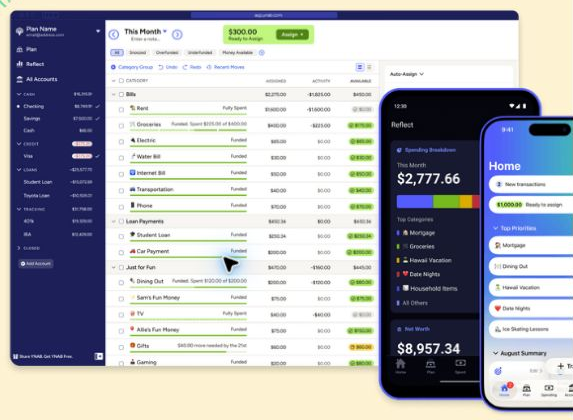
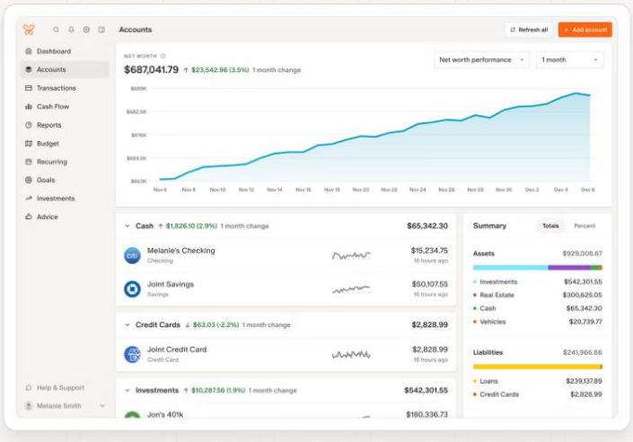
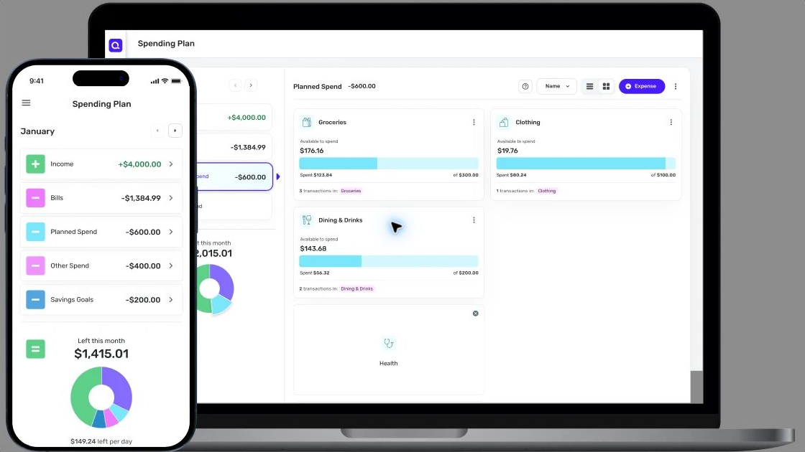
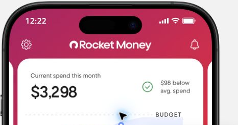
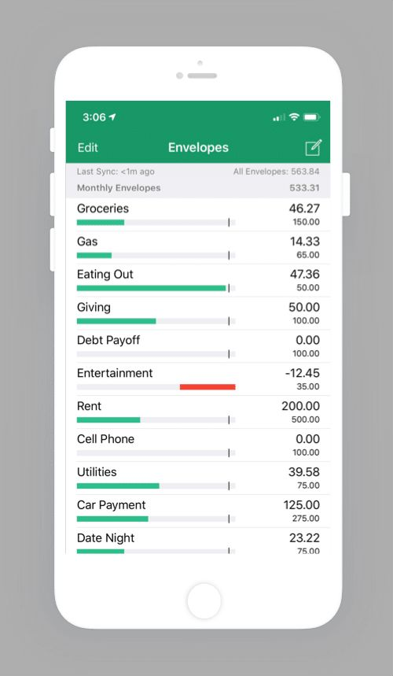
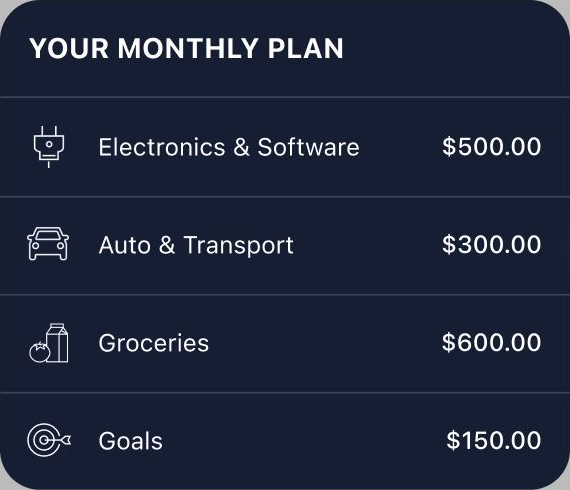
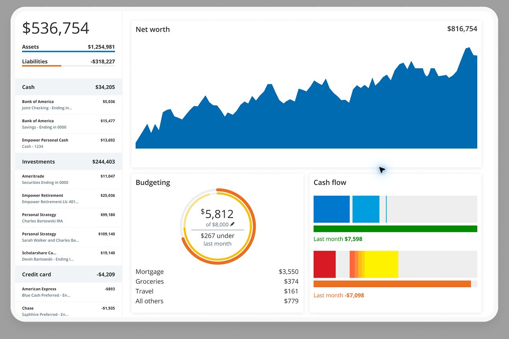

# Best Budgeting Apps for 2026: 7 Apps Compared by Cost, Method and Best Use

A budgeting app can do several very different jobs. Some ask you to decide where every dollar goes before you spend it. Others quietly sort transactions, track subscriptions, show your net worth, or help two people run the same household.

That is why the best budgeting apps are not simply the ones with the longest feature lists. The better question is which app fits the way you already manage money, and which problem you want it to fix first.

FinLoom compared seven of the best budgeting apps for 2026 using each company's own pricing, help, security and product pages, checked on November 5, 2026. We did not test every product for months, and we do not rank apps by app-store stars. Each pick below is tied to a specific budgeting job.

## Key Takeaways

- YNAB fits people who want a hands-on, zero-based method and can live with a learning curve.
- Monarch suits couples who want one shared view of budgets, bills, investments and net worth.
- Quicken Simplifi is the lower-cost paid option, but its $3.99 monthly price is a promotion billed annually.
- Rocket Money is strongest for subscriptions, and bill negotiation now sits in its Premium+ plan.
- Goodbudget and PocketGuard keep budgeting simple, while Empower adds free net-worth and investment tracking.

## Best Budgeting Apps at a Glance

The table below summarizes price, the free option, and the main tradeoff for each app. Prices were checked on the companies' websites on November 5, 2026 and can change at checkout.

| App | FinLoom pick | Current price | Free option | Main tradeoff |
|---|---|---|---|---|
| YNAB | Best for zero-based budgeting | $109 per year or $14.99 per month | 34-day trial | Hands-on method with a learning curve |
| Monarch | Best for couples and households | Core $99.99 per year or $14.99 per month | 7-day trial | No permanent free tier |
| Quicken Simplifi | Best lower-cost paid all-rounder | $3.99 per month billed annually (promotional; $6.99 regular) | No permanent free tier | Promotional price can change |
| Rocket Money | Best for subscriptions and bills | Free; Premium on a sliding scale; Premium+ $15 per month plus tax | Yes | Best features sit in paid tiers |
| Goodbudget | Best for envelope budgeting | Free; Premium $10 per month or $80 per year | Yes | Free tier is deliberately limited |
| PocketGuard | Best for spending guardrails | $12.99 per month, $74.99 per year or $149.99 lifetime | 7-day trial | Lighter on long-range planning |
| Empower Personal Dashboard | Best free net-worth overview | Free | Yes | Budgeting is lighter than YNAB or Monarch |

Treat promotional pricing as a starting point, not a fixed cost. Check the renewal price before you subscribe, and set a reminder before any trial ends.

## How We Chose These Apps

Our list of the best budgeting apps is an editorial comparison built from official pricing, feature, help, security and disclosure pages. We gave the most weight to six questions:

1. **Budgeting method.** Does the app help you plan spending, or mostly report what already happened?
2. **Real cost.** What do you pay after the trial or promotion ends?
3. **Account coverage and syncing.** Will your bank, card, loan and investment accounts stay connected?
4. **Household use.** Can a partner join, and does that cost extra?
5. **Useful automation.** Recurring bills, transaction rules, goals, debt tools and subscription detection.
6. **Honest tradeoffs.** What does each app do poorly, not only what it markets well?

We also kept budgeting separate from broader money tracking. An app can be excellent for net worth and still be weak for someone who needs a strict monthly spending plan.

## 1. YNAB: Best for Zero-Based Budgeting

**Best for:** People who want an active budgeting method rather than a passive spending tracker  
**Price:** $109 per year or $14.99 per month  
**Trial:** 34 days when you sign up directly through YNAB  
**Household sharing:** Up to six people on one subscription

YNAB is the most method-driven app in this group. Instead of starting with a report of where last month's money went, it asks you to give the money you already have a job. That makes it useful for people who reach the end of each pay cycle wondering where the cash went.

The method is also why YNAB can feel demanding at first. Imported transactions need attention, categories need to reflect real priorities, and the system works best when you are willing to make tradeoffs as spending changes. Someone who only wants automatic categorization may find Monarch or Simplifi easier.

[YNAB's pricing page](https://www.ynab.com/pricing) lists $109 per year or $14.99 per month, with a 34-day trial for direct sign-ups. It also says one subscription can be shared with partners, family or other close groups of up to six people. That sharing makes the annual price easier to justify for a household that uses the system together.

YNAB is less about monitoring and more about changing behavior. If you want the app to tell you what remains after your priorities are funded, that structure is valuable. If you already manage cash flow comfortably and only want reports, paying for the method may be unnecessary.

## 2. Monarch: Best for Couples and Households

**Best for:** Couples and households that want budgeting, cash flow, net worth, investments and goals in one place  
**Price:** Core $99.99 per year or $14.99 per month; Plus costs more  
**Trial:** 7 days  
**Connectivity:** More than 13,000 financial institutions, according to Monarch

Monarch is the broadest personal-finance dashboard in this comparison. It can combine checking, savings, credit cards, loans, investments, mortgages, real estate and other accounts, then layer budgets, cash-flow reports, recurring charges, goals and net-worth tracking on top.

Its strongest advantage is household collaboration. Monarch says you can invite a partner to see your full picture at no extra cost, so both people work from the same numbers. That helps when the real problem is not building a budget but getting two people to look at one shared view.

Monarch also offers a Plus tier for members who want forecasting tools, tracking for several income sources such as a small business, and deeper investment views. Those additions help households with side businesses or more complex finances, but many users will not need them.

The drawback is price. There is no permanent free tier, and a seven-day trial is short next to YNAB's 34 days. Couples should also understand that shared access is built for transparency, so both people see the same financial picture.

## 3. Quicken Simplifi: Best Lower-Cost Paid All-Rounder

**Best for:** People who want automatic tracking and cash-flow forecasting without paying around $100 a year  
**Current advertised price:** $3.99 per month billed annually, shown as a promotion against a $6.99 regular price  
**Important:** The promotional price can change at renewal

Quicken Simplifi sits between a strict budgeting system and a broad financial dashboard. Its Spending Plan starts with income and bills, then shows what remains after planned expenses and savings goals. For people who dislike assigning every dollar to a category, that can feel more natural than zero-based budgeting.

The app also includes projected cash flow, savings goals, spending watchlists, reports and investment tracking. The cash-flow view helps users whose main worry is timing: whether upcoming bills, income and goals fit together over the next several weeks.

Price is the main attraction, but it needs careful wording. The Simplifi page showed $3.99 per month billed annually next to a $6.99 regular price when we checked. A reader should not assume the introductory price is permanent.

Simplifi is a sensible middle ground for someone who wants a real budget and useful forecasts but does not want YNAB's learning curve or Monarch's higher annual cost.

## 4. Rocket Money: Best for Subscriptions and Bill Management

**Best for:** People who suspect recurring charges and subscriptions are quietly inflating monthly spending  
**Price:** Free tier; Premium on a sliding scale; Premium+ $15 per month plus tax  
**Recent change:** Bill negotiation moved to Premium+ on November 2, 2026

Rocket Money starts from a different problem than YNAB. Its main appeal is finding recurring charges, surfacing subscriptions, organizing spending, and helping users act on expenses they no longer want.

The free plan covers subscription tracking, spend reviews and bill reminders. Premium adds custom budget categories, goal plans, credit score tracking and real-time syncing, with a price you choose on a sliding scale. Premium+ costs a fixed $15 per month plus tax and adds Rowan, Rocket Money's AI assistant, eligible high-yield savings access, and bill negotiation without a separate success fee.

The bill-negotiation change makes older reviews out of date. According to [Rocket Money's help center](https://help.rocketmoney.com/en/articles/2217739-how-much-does-rocket-money-cost), bill negotiation became exclusive to Premium+ members on November 2, 2026. Negotiations submitted before that date finish under the old success-fee agreement.

Rocket Money is compelling when the first job is expense cleanup. It is less compelling if you need a disciplined forward-looking budget or a detailed investment dashboard.

## 5. Goodbudget: Best for Envelope Budgeting

**Best for:** People who like the envelope method and do not need every account imported automatically  
**Price:** Free; Premium $10 per month or $80 per year

Goodbudget turns the envelope method into a digital system. You create envelopes for categories and divide available money between them. That simplicity can be a strength for people who find feature-heavy dashboards distracting.

[Goodbudget's plan page](https://goodbudget.com/signup) lists a free plan with 10 regular envelopes, 10 more envelopes for annual or goal spending, one account, two devices, one year of history and debt tracking. Premium expands that to unlimited envelopes and accounts, five devices, seven years of history and automatic bank sync for U.S. banks.

The difference between the two plans is worth reading closely. Goodbudget can work well as a deliberately manual budget. Users who expect every account to sync automatically should look at Premium or choose another app.

Goodbudget shows that a budgeting tool does not need to become a full financial command center to be useful. Its appeal is the method itself.

## 6. PocketGuard: Best for Spending Guardrails and Debt Payoff

**Best for:** People who want a quick view of available spending after bills and goals  
**Price:** $12.99 per month, $74.99 per year, or $149.99 for lifetime access  
**Trial:** 7 days

PocketGuard focuses on reducing the mental math behind daily spending. Its budgeting tools are built around income, recurring commitments, goals, and the amount left over.

It includes unlimited category budgets, rollover budgeting, subscription tracking, recurring bills, custom goals and a debt payoff plan. The lifetime purchase option is unusual in a market of subscriptions and may appeal to someone who expects to use the same system for years.

The tradeoff is depth. PocketGuard is a budgeting and spending-control product first. If detailed investment analysis, shared household views or long-range planning sit at the center of your decision, Monarch or Empower is the more natural comparison.

## 7. Empower Personal Dashboard: Best Free Net-Worth and Investment Overview

**Best for:** People who want one free dashboard for spending, investments, retirement and net worth  
**Price:** Free

Empower Personal Dashboard is the outlier on this list because its strongest value is not strict category budgeting. It is the ability to connect many financial accounts and see spending, cash flow, investments, retirement planning, debt and net worth together without paying for the dashboard.

That makes Empower useful for someone who has moved past "Can I stay inside my grocery category?" and is now asking how cash, retirement accounts, investments and debt fit together.

Empower says its dashboard and financial tools are completely free and that it uses multiple layers of security. The free tools cover budgeting and cash flow, net worth, retirement planning and investment views.

The tradeoff is that budgeting is less method-driven than YNAB and less collaborative than Monarch. Empower also runs a wealth-management business, so some users may hear about its advisory services.

## Which Budgeting App Is Best for You?

The easiest way to narrow the best budgeting apps is to start with the money problem you are trying to solve. Find the row that sounds most like you.

| If your main problem is... | Start with... |
|---|---|
| I spend money before deciding what it is for | YNAB |
| My partner and I need one shared financial view | Monarch |
| I want an affordable paid tracker with cash-flow forecasts | Quicken Simplifi |
| I keep finding subscriptions and recurring charges | Rocket Money |
| I like the envelope method | Goodbudget |
| I want a simple spending limit and debt tools | PocketGuard |
| I want free net-worth and investment tracking too | Empower |

A paid app is not automatically better. If you only review spending once a month, a spreadsheet or your bank's own tools may be enough. Paying $80 to $150 a year makes more sense when the app changes decisions, saves time, helps a household coordinate, or replaces several tools.

Budgeting also works best alongside a plan for what the money is for. FinLoom's guide to [saving vs investing](/money-banking/saving-vs-investing/) explains how time horizon decides whether spare cash belongs in savings or in the market.

## What Makes a Budgeting App Safe?

"Safe" can mean several things, and app lists often blur them together. These three checks cover the basics:

- **How accounts connect:** Many apps link to banks through data aggregators rather than storing your bank login themselves, so check which method the app uses.
- **What the app can do:** Read-only access means the app can view transactions but cannot move money. Monarch, for example, says it has read-only permissions.
- **How data is protected:** Look for encryption, multi-factor sign-in, a published security page, and a clear privacy policy.

A paid subscription does not guarantee stronger privacy. What counts is the company's actual data policy and design. Read the privacy policy before connecting every account you own.

If you are uncomfortable linking accounts at all, a manual system such as Goodbudget's free plan reduces how much financial data you share, though you give up automation.

## Free vs. Paid Budgeting Apps

Among the best budgeting apps, free plans make the most sense when you want basic spending visibility or net-worth tracking. Paid apps earn their cost when they add a method, household collaboration, more reliable syncing, rules, longer history, forecasts, or hands-on subscription and bill tools.

Cost needs context too. A $100 yearly subscription is expensive if you open the app twice. It can be cheap if it helps a couple avoid repeated overdraft fees, cancel unused subscriptions, or fund savings goals on schedule.

One useful test is to put a number on the goal the app supports. If a budget frees $100 a month for savings, the [savings interest calculator](/money-banking/savings-interest-calculator/) shows what that money could grow to at a given APY.

### When a Free App Is Enough

A free tier usually covers you when your accounts are simple and you mainly want visibility. Someone with one checking account, one credit card and steady bills can often get what they need from Goodbudget's free plan, Rocket Money's free tracking or Empower's dashboard without paying anything at all.

### When Paying Makes Sense

Paying tends to make sense when a household needs shared access, when you want a structured method such as zero-based budgeting, or when bank sync reliability is worth money to you. It also makes sense if one feature, such as subscription cancellation or bill negotiation, saves more than the plan costs each year.

## Budgeting for Health Costs and Irregular Bills

Most budgeting apps handle rent, groceries and subscriptions well. Irregular costs are harder: medical bills, annual insurance premiums, car repairs and holiday spending. A budget that ignores them tends to break the first time one arrives.

The fix is to plan for these costs before they arrive. YNAB and Goodbudget handle this with categories or envelopes that you fund a little each month. Monarch and Simplifi let you track savings goals, and PocketGuard lets you set custom goals inside its plan.

Health costs deserve a separate look because tax-advantaged accounts can pay some of them. If your employer offers a health savings account or a flexible spending account, the comparison of [HSA vs FSA](/money-banking/hsa-vs-fsa/) explains how each one works and which costs they cover. Money in those accounts can then be tracked as its own category inside whichever app you choose.

## How FinLoom Would Choose Among These Seven

There is no single winner among the best budgeting apps. The right pick depends on the job:

- **For structure:** YNAB has the clearest budgeting framework.
- **For couples:** Monarch gives the broadest shared financial view.
- **For a lower price:** Quicken Simplifi is easier to justify, as long as you watch the renewal price.
- **For subscriptions:** Rocket Money is the specialist when recurring charges are the main problem.
- **For simplicity:** Goodbudget and PocketGuard keep the budget easy to follow.
- **For net worth:** Empower fits someone whose questions now center on investments and retirement.

The most important choice is not the logo on the app. It is whether the system matches the money decisions you need to make every week. Try one app through its full trial before paying, and give it at least one complete pay cycle before you judge it.

## Frequently Asked Questions

### What Are the Best Budgeting Apps for Beginners?

Quicken Simplifi and PocketGuard have straightforward setups, while YNAB offers more structure but takes longer to learn. Choose based on whether you want automatic tracking or an active method.

### Is There a Completely Free Budgeting App?

Goodbudget has a free-forever plan and Empower Personal Dashboard is free. Rocket Money also offers free features. Each one limits or emphasizes different tools, so free plans are not equal.

### What Is the Best Budgeting App for Couples?

Monarch suits shared household finances because a partner can join at no extra cost. YNAB allows up to six people on one subscription for zero-based budgeting.

### Is YNAB Worth Paying For?

YNAB can be worth $109 a year when its method changes how you plan and spend. It is harder to justify if you only want automatic tracking and reports.

### Did Rocket Money Change Its Bill Negotiation Service?

Yes. Since November 2, 2026, bill negotiation is available only to Premium+ members, at $15 per month plus tax, with no added success fee for new negotiation requests.

### Can Budgeting Apps Move Money From My Bank Account?

Many budgeting apps use read-only connections that only view transactions, but features vary. Some offer savings, transfer or bill tools, so review the exact permissions before you connect any account.

## Resources

- [YNAB pricing](https://www.ynab.com/pricing)
- [YNAB security](https://www.ynab.com/security)
- [Monarch pricing](https://www.monarch.com/pricing)
- [Monarch security](https://www.monarch.com/security)
- [Quicken Simplifi](https://www.quicken.com/simplifi)
- [Rocket Money: how much does Rocket Money cost?](https://help.rocketmoney.com/en/articles/2217739-how-much-does-rocket-money-cost)
- [Goodbudget plans](https://goodbudget.com/signup)
- [PocketGuard pricing](https://pocketguard.com/pricing/)
- [Empower financial tools](https://www.empower.com/tools)

*Prices, trial terms, features and bank connectivity can change. This article is educational and is not individualized financial advice.*
