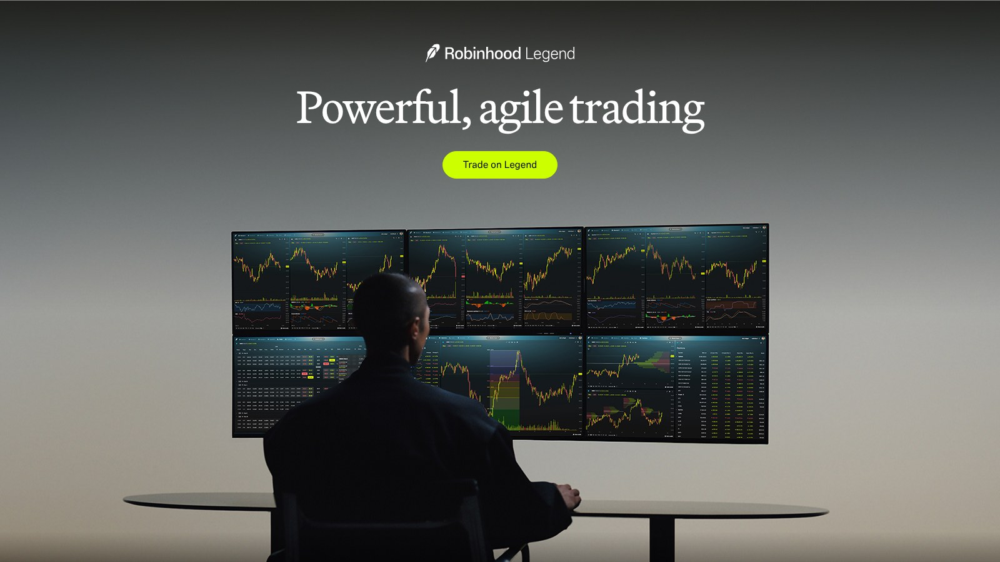
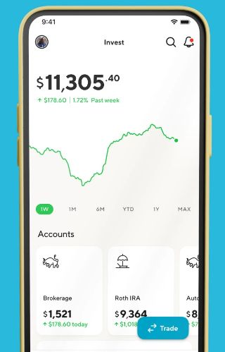
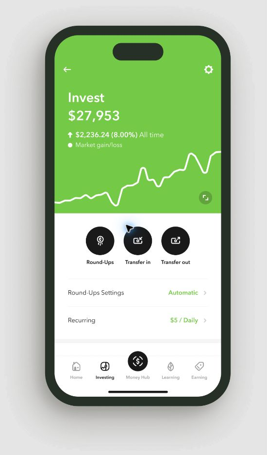
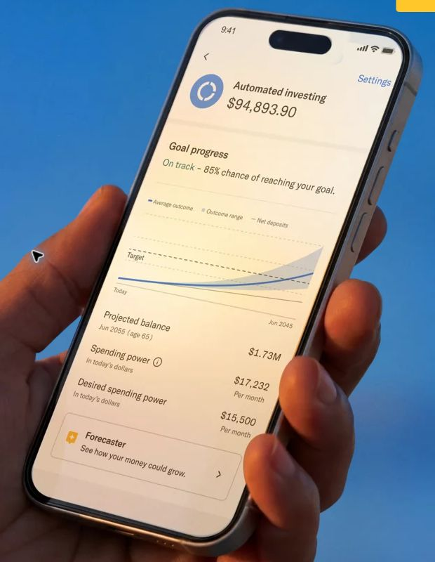
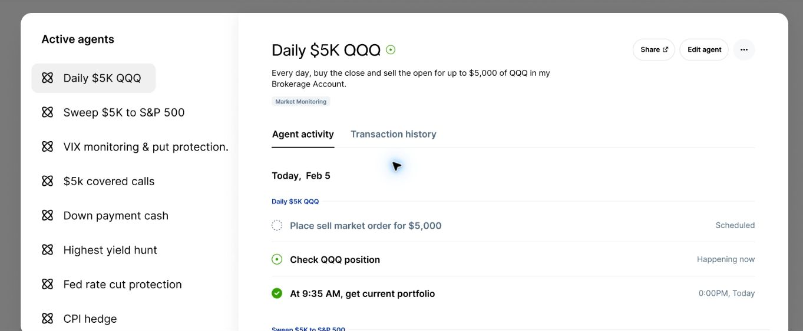

# Best Investment Apps for 2026: 6 Platforms Compared by Fees, Automation and Investor Fit

Most major brokers now advertise commission-free stock trades. That makes a $0 commission a poor way to choose between the best investment apps.

The bigger differences sit behind the account-opening screen: which account types you can open, whether fractional shares and recurring investments are supported, what automation costs, what research you get, whether an IRA match comes with holding conditions, and which assets SIPC or FDIC coverage protects.

FinLoom reviewed official pricing, disclosure, help and product pages for the platforms below between November 5 and November 6, 2026. We did not treat awards or app-store stars as proof that one app is better for everyone. Each pick is tied to a specific investing job, and none of this is a recommendation to buy any investment.

## Key Takeaways

- Fidelity fits long-term investors who want fractional shares from $1, no account minimum and a free robo option under $25,000.
- Robinhood offers a 3% IRA match with Gold at $5 a month, but matched assets must stay in the IRA for at least 5 years.
- SoFi Robo Invest charges a 0.25% fee and suits beginners who want self-directed and automated investing in one app.
- Acorns charges $4, $8 or $12 a month, which is costly on small balances but useful for automatic saving.
- Betterment is the most focused robo-advisor here, and Public stands out for bonds, Treasuries and AI research tools.

## Best Investment Apps at a Glance

The table compares each platform's FinLoom pick, its main cost, and its main tradeoff. Figures come from each company's own pages, checked November 5 and 6, 2026.

| Platform | FinLoom pick | Key cost | Automation | Main tradeoff |
|---|---|---|---|---|
| Fidelity | Best overall for long-term investors | $0 online U.S. stock, ETF and option commissions; $0.65 per options contract | Fidelity Go: $0 under $25,000, 0.35% at $25,000 and above | Feature depth can feel dense |
| Robinhood | Best mobile-first option with an IRA match | Gold costs $5 per month or $50 per year | Gold adds features and a larger IRA match | Match requires a 5-year hold |
| SoFi Invest | Best beginner hybrid | Robo Invest fee of 0.25% | Robo Invest manages an ETF portfolio | Research depth trails full brokers |
| Acorns | Best for automatic micro-investing | Bronze $4, Silver $8, Gold $12 per month | Round-Ups and recurring deposits | Flat fee is high on small balances |
| Betterment | Best robo-advisor | Digital 0.25% or $5 per month; Premium 0.65% | Managed portfolios and rebalancing | Advisory fee plus fund expenses |
| Public | Best for multi-asset access and AI research | Fee schedule varies by product | Direct indexing and AI agents | More products mean more fee schedules |

This list sticks to apps you use to invest, not dedicated stock-research tools. Charles Schwab was in our original shortlist, but its website blocked every automated request we made, so we could not confirm its current fees and left it out rather than publish unchecked figures.

## How We Evaluated Investment Apps

To rank the best investment apps, we weighed six factors. None of them is the commission alone.

### Total Cost Beyond the Headline Commission

A $0 stock commission can sit beside option contract fees, advisory fees, subscriptions, fund expense ratios, margin interest, transfer fees and paid data. On small balances, a flat monthly subscription can cost more than a percentage advisory fee, so we compared what each app costs at different account sizes rather than repeating the word free.

### Account Types and Portability

An app that works for a taxable account may be a poor long-term home if you later need a Roth IRA, Traditional IRA, rollover IRA or custodial account. We also read the conditions attached to IRA matches and transfer bonuses, because holding periods and recapture terms are part of the product, not footnotes in small print.

### Fractional Shares, Automation and Research

Dollar-based investing, recurring purchases, automatic rebalancing and managed portfolios help many long-term investors more than advanced order types. Some investors want a minimal app, while others need screeners, analyst research, bond tools or phone support, so we noted which kind of investor each platform serves best.

### Protection and Custody

Brokerage securities can be covered by SIPC when held at a member broker-dealer, within SIPC's limits. Bank deposits may be FDIC-insured through an insured bank or sweep program. Crypto is not automatically protected by either just because it appears inside an investing app, so we checked how each platform describes its coverage.

## 1. Fidelity: Best Overall for Long-Term Investors

**Best for:** Investors who want one platform that can grow from a first account into retirement, funds, bonds and research  
**Online U.S. stock, ETF and option commissions:** $0, with a $0.65 fee per options contract  
**Fractional shares:** From $1  
**Account minimum:** None to open a brokerage account  
**Automated option:** Fidelity Go

Fidelity earns the top spot because it does not force a choice between simplicity and depth. A beginner can buy fractional shares and set recurring investments, while a more experienced investor can use Fidelity's research, bond tools, mutual fund lineup and retirement accounts without moving firms.

[Fidelity's commission schedule](https://www.fidelity.com/trading/commissions-margin-rates) lists $0 commissions for online U.S. stock, ETF and option trades, with a $0.65 fee per options contract. Its brokerage page says there is no minimum to open an account and that fractional investing starts at $1.

Fidelity Go adds a managed option. Fidelity lists $0 advisory fees on balances under $25,000 and 0.35% a year at $25,000 or more, when one-on-one financial coaching also becomes available. That fee applies to the managed service, not to a standard self-directed brokerage account.

Fidelity's breadth can make it feel more complex than a mobile-first app. Also, do not assume every asset under the Fidelity name has the same protection: Fidelity states that crypto is not insured by the FDIC or SIPC.

## 2. Robinhood: Best Mobile-First Option With an IRA Match

**Best for:** Investors who want a simple mobile experience and can keep IRA match money in place  
**Gold:** $5 per month or $50 per year  
**IRA match:** 3% on eligible annual contributions with Gold, 1% without Gold  
**Holding rule:** Matched assets must stay in the IRA for at least 5 years

Robinhood helped make commission-free mobile trading the industry norm, and its product now covers far more than stock trading. Its home page lists stocks, ETFs, crypto, options, futures and prediction markets, with investing starting at $1.

The IRA match is the standout benefit for long-term investors. [Robinhood's IRA match FAQ](https://robinhood.com/us/en/support/articles/ira-match-faq/) says Gold members earn a 3% match on annual contributions to self-directed IRAs and other members earn 1%. It also says you must hold the assets that earned the match in your IRA for at least 5 years.

Gold costs $5 a month or $50 a year. Robinhood also offers Legend, a desktop platform for charting and active trading, and newer agent features. These tools add real capability, but they sit beside products whose risks are very different from buying a diversified fund each month.

Robinhood is built to reduce friction. That helps with recurring investing but can also make options, margin and crypto feel as easy as buying an ETF. Read each product's risk disclosure before using it.

## 3. SoFi Invest: Best Beginner Hybrid

**Best for:** Beginners who want self-directed investing and a robo option inside one broader financial app  
**Robo advisory fee:** 0.25% of account value

SoFi Invest suits someone who is not yet sure whether to manage a portfolio personally or have a service do it. Its self-directed accounts let users pick their own investments, while Robo Invest builds and manages an ETF portfolio based on goals and risk tolerance.

SoFi's automated investing page states that the 0.25% fee is based on account value. Underlying fund expenses come on top of that fee, so the advisory charge is not the full cost of the managed portfolio.

SoFi also makes sense for someone already using the company for banking or borrowing. Fewer financial apps is a practical convenience, though not an investment return.

The tradeoff is depth. SoFi's research and trading tools are not as deep as Fidelity's. A new investor may not mind. Someone who later wants advanced screeners or fixed-income tools may outgrow it.

## 4. Acorns: Best for Automatic Micro-Investing

**Best for:** People who need automation more than investment selection  
**Price:** Bronze $4, Silver $8 or Gold $12 per month  
**Retirement:** Acorns Later, with first-year IRA matches on Silver and Gold

Acorns solves a behavior problem: getting money invested consistently. Round-Ups can move spare change from purchases into a portfolio, while recurring deposits and managed portfolios reduce how often you need to make decisions.

Acorns' pricing page lists Bronze at $4 a month, Silver at $8 and Gold at $12. Silver adds a 1% IRA match on new contributions during your first year, and Gold raises that first-year match to 3%.

The flat subscription deserves attention on small balances. Bronze costs $48 a year, which equals 4.8% of a $1,000 balance before fund expenses. On a $20,000 balance, the same $48 is 0.24%. The price did not fall. It only became smaller relative to the money invested.

Acorns works best when automation gets you to invest money you otherwise would not save. If you already buy ETFs on a schedule, a no-subscription brokerage can do the same job for less.

## 5. Betterment: Best Robo-Advisor

**Best for:** Investors who want portfolio construction, rebalancing and tax-aware automation rather than stock picking  
**Digital:** 0.25% a year for $24,000 to $1 million or with $200+ in monthly recurring deposits; otherwise $5 a month  
**Premium:** 0.65% a year, including access to financial consultants

Betterment is a clear example of a robo-advisor rather than an app-first brokerage. You set goals and a risk level, and Betterment builds and manages a diversified ETF portfolio, including rebalancing and tax tools where they apply.

Betterment's fee disclosure states that Digital costs 0.25% a year for balances from $24,000 to $1 million or with at least $200 in monthly recurring deposits, and $5 a month otherwise. Premium costs 0.65% a year and includes access to its team of financial consultants.

The image above shows a sample goal forecast from Betterment's own marketing. Projections like these are estimates, not promised results. Underlying funds also charge their own expense ratios, so the advisory fee is not the entire cost.

Betterment is not the right fit if your main goal is trading individual stocks. It earns its fee by automating portfolio decisions. Investors who do not need that service can buy diversified ETFs themselves at a low-cost broker.

## 6. Public: Best for Multi-Asset Access and AI Research Features

**Best for:** Investors who want stocks, ETFs, bonds, Treasuries, options and AI research tools in one interface  
**Accounts:** Traditional and Roth IRAs  
**Notable tools:** AI agents, an AI research tool called Alpha, and direct indexing

Public has grown well beyond its social-investing roots. Its site lists stocks, ETFs, options, crypto, fractional corporate bonds, a Treasury ladder builder, Traditional and Roth IRAs, and direct index accounts.

Its AI features set it apart. Public describes an agentic brokerage tool that acts on the instructions you set, plus Alpha, an experimental AI research tool that Public warns may produce inaccurate answers. The screenshot below shows example agents from Public's own marketing.

The sample agents in that image are Public's examples, not strategies FinLoom suggests. Automated trading rules can lose money quickly, and Public's own disclosures say the agents act on your instructions.

Public's fees depend on the product. Options, crypto, bonds, premium features and managed accounts each have their own terms, so read the customer fee schedule before you trade anything beyond basic stocks and ETFs.

## How Much Do Investment Apps Really Cost?

The headline commission is often the least useful number. A simple example shows why account size changes the math.

| Account balance | Acorns Bronze ($48 a year) | 0.25% advisory fee |
|---|---|---|
| $1,000 | $48, or 4.8% | $2.50, though Betterment's $5 monthly minimum may apply |
| $20,000 | $48, or 0.24% | $50 |
| $100,000 | $48, or 0.048% | $250 |

These figures are illustrative and exclude fund expenses. Neither structure is better in every case. The useful question is what you receive for the fee and whether you need it.

The same logic applies to paid memberships. Paying for a larger IRA match can make sense for someone who contributes enough and keeps the money in place. It can be poor value for someone who pays the subscription but barely funds the account.

## IRA Matches: Read the Conditions, Not Just the Percentage

IRA contribution matches have become a common way for investing apps to compete for retirement money. Robinhood and Acorns both offer them, with different rules.

Before you count a match as free money, check these points:

- **Membership:** Robinhood's 3% match needs Gold, and Acorns' first-year matches need Silver or Gold.
- **Scope:** Some matches cover new contributions only, while others also cover transfers.
- **Holding period:** Robinhood requires matched assets to stay in the IRA for at least 5 years.
- **Duration:** Acorns' matches apply to contributions during your first year.

A 3% match on a fully funded IRA can outweigh years of subscription fees, but only if you meet the terms. Read the current offer before you contribute or transfer.

## SIPC vs. FDIC: What Protection Does an Investment App Have?

These terms are often used loosely, so it helps to separate them.

**SIPC** protects customers when a member brokerage firm fails. [SIPC states](https://www.sipc.org/for-investors/what-sipc-protects) that its limit is $500,000, including a $250,000 limit for cash, and that it does not protect against a decline in the value of your securities.

**FDIC insurance** covers eligible deposits at insured banks, including some cash sweep programs. It does not insure the value of stocks, ETFs or bonds.

**Crypto is different.** A brokerage can be a SIPC member while crypto held through a separate affiliate sits outside that protection. Fidelity states plainly that crypto is not insured by the FDIC or SIPC. The practical question is not whether an app is insured but which legal entity holds each asset, and what protection applies to it.

## Which Investment App Is Best for Beginners?

Among the best investment apps, a beginner does not need the simplest screen. The better start is a platform that supports sound habits without forcing a move later.

Fidelity fits someone who expects to build a long-term portfolio and retirement accounts. SoFi is easier for someone who wants to switch between self-directed and automated investing. Acorns helps when saving consistently is the hard part. Robinhood is easy to use and offers an IRA match, but easy access to complex products is not a reason to use them.

Choosing what to buy should come before choosing where to buy it. FinLoom's comparison of an [index fund vs mutual fund](/investing/index-fund-vs-mutual-fund/) explains the fund types most long-term portfolios start with.

## Which Investment App Is Best for Hands-Off Investing?

Of the best investment apps here, Betterment is the clearest hands-off choice because portfolio management is the product itself. Fidelity Go and SoFi Robo Invest are alternatives when you want automation inside a larger brokerage or banking app.

Hands-off investors often hold broad index funds. If you prefer to build that portfolio yourself, the guide to the [best S&P 500 index fund](/investing/best-sp500-index-funds/) options compares costs and structures among the largest funds.

## How Investing Apps Fit a Wider Portfolio

Even the best investment apps are only containers. What you hold inside it shapes risk and return far more than the interface. Stocks, funds and crypto behave very differently in downturns, and an app that puts them side by side can make them look alike.

FinLoom's comparison of [crypto vs stocks](/investing/crypto-vs-stocks/) shows how volatility, drawdowns and liquidity differ between the two, which helps when an app offers both in one screen.

## The Best App Is the One That Fits the Account You Are Building

The market for the best investment apps has moved past the point where a $0 commission separates them. Fidelity is hard to beat when you want a brokerage that grows with you. Robinhood and Public push hardest on mobile features, incentives and AI. SoFi lowers the barrier between self-directed and automated investing. Acorns makes consistency the product, and Betterment makes portfolio automation the product.

Choose the investing job first. Then compare the fee structure, account types, custody, protection and portability that come with it. Investing involves risk, including possible loss of principal, whatever app you use.

## Frequently Asked Questions

### What Are the Best Investment Apps for Beginners?

Fidelity is a strong start because it combines no account minimum, fractional shares from $1 and retirement accounts. SoFi and Acorns can feel simpler for beginners who want automation.

### Which Investment App Has No Fees?

Many brokers charge $0 commissions on online U.S. stock and ETF trades, but accounts still carry costs. Options, subscriptions, advisory services, funds, transfers and margin can all add fees.

### Are Investment Apps Safe?

Regulated U.S. brokers must follow securities rules, but investments can still lose value. Check the broker, its custody setup, SIPC membership, cash sweep terms and the protection for each asset.

### Is Robinhood's IRA Match 3%?

Robinhood offers a 3% match on eligible IRA contributions with Gold, which costs $5 a month or $50 a year. Matched assets must stay for 5 years.

### Is Betterment Cheaper Than Acorns?

It depends on your balance. Acorns' flat fee is costly on small accounts, while Betterment's 0.25% fee grows with assets. Betterment charges $5 a month below its Digital thresholds.

### Does SIPC Protect Crypto?

Generally, no. SIPC covers qualifying securities and cash at a failed member broker, up to $500,000. Crypto held through separate custodians or affiliates is typically outside that protection.

## Resources

- [Fidelity commissions and margin rates](https://www.fidelity.com/trading/commissions-margin-rates)
- [Fidelity brokerage account](https://www.fidelity.com/investing/brokerage-account)
- [Fidelity Go overview](https://www.fidelity.com/managed-accounts/fidelity-go/overview)
- [Robinhood Gold overview](https://robinhood.com/us/en/support/articles/gold-overview/)
- [Robinhood IRA match FAQ](https://robinhood.com/us/en/support/articles/ira-match-faq/)
- [SoFi automated investing](https://www.sofi.com/invest/automated/)
- [Acorns pricing](https://www.acorns.com/pricing/)
- [Betterment fee disclosure](https://www.betterment.com/legal/fee-disclosure)
- [Public customer fee schedule](https://public.com/disclosures/customer-fee-schedule/)
- [SIPC: what SIPC protects](https://www.sipc.org/for-investors/what-sipc-protects)

*Investing involves risk, including possible loss of principal. This article is educational and is not personalized investment, tax or legal advice. Fees, promotions, account terms and product features can change.*
