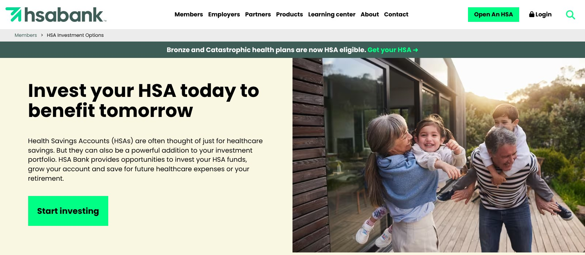
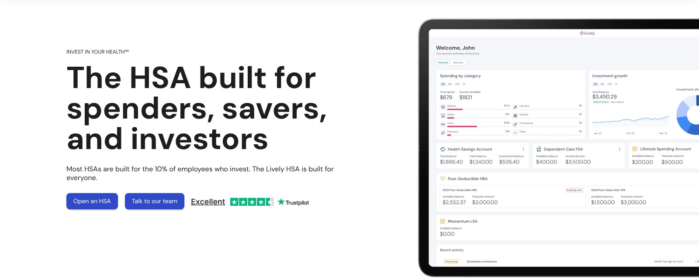

# Best HSA Accounts for 2026: Cash, Investing, and Fees Compared

A health savings account can do two different jobs. Some people use it like a checking account for prescriptions, dental work and current medical bills. Others pay health costs from regular income and invest the HSA balance for later years. A provider that suits one job may not suit the other.

That is why the best HSA accounts depend on how you plan to use the money. FinLoom compares three providers through those two lenses, using each provider's own fee and product pages checked on November 6, 2026, together with the IRS rules for 2026. Employer plans can carry different fees and investment menus, so your own account agreement still has the final word.

## Key Takeaways

- Fidelity's HSA has no account fees and no minimums, and its default cash position is a money market fund rather than an insured bank deposit.
- HSA Bank charges 0.10%, 0.25% or 0.35% a year on invested balances, waived in any quarter your average cash balance is $7,500 or more.
- Lively is free for individuals and lets you invest from your first dollar through Schwab or a Devenir portfolio, with optional fees.
- The 2026 HSA limits are $4,400 for self-only coverage and $8,750 for family coverage, plus $1,000 at age 55 or older.
- Non-medical withdrawals before 65 face income tax and usually an extra 20% tax.

## 2026 HSA Providers at a Glance

The table compares the three providers on account fees, investing and what to check before you open an account. Figures come from each provider's own pages, checked November 6, 2026.

| Provider | Account fees | How investing works | Where it stands out | What to check |
|---|---|---|---|---|
| Fidelity HSA | No account fees and no minimums | Self-directed or Fidelity Go managed | Low friction for spending and investing | Default cash is a money market fund |
| HSA Bank | Depends on your plan | Choice 0.10%, Select 0.25%, Managed 0.35% a year | Three investment paths | Fees waived only with $7,500 average cash |
| Lively | Free for individuals and families | Schwab self-directed or Devenir guided, optional fee | Invest from the first dollar | Fees for the investment option you pick |

These are not FinLoom's own product tests. We did not open accounts, and we did not rank providers by marketing awards. HealthEquity and Saturna were on our original shortlist, but their websites blocked our automated checks, so we left them out rather than publish fees we could not confirm.

## How We Compared HSA Providers

Before comparing names, it helps to decide what you want the account to do over the next 12 months. We judged each provider against two different users.

### The Spending User

Someone who expects to pay medical bills from the HSA this year cares most about account fees, debit card access, reimbursements and where the cash sits. A provider with no monthly fee and an easy cash position fits this user, even if its investment menu is thin.

### The Investing User

Someone with enough cash elsewhere may want to leave the HSA invested for years. For this user, investment fees, fund choice, any cash balance required before investing, and the cost of staying invested through market declines count far more than the debit card.

## Fidelity HSA: A Strong All-Round Choice

**Best for:** People who want one HSA for both current bills and long-term investing  
**Account fees:** None for individuals and employers opening through Fidelity.com  
**Minimums:** None to open or to start investing  
**Managed option:** Fidelity Go, $0 advisory fee under $25,000 and 0.35% at $25,000 or more

[Fidelity's HSA page](https://www.fidelity.com/investing/hsa) states that there are zero account fees and zero account minimums for Fidelity HSAs offered through Fidelity.com to individuals and employers. Commissions or fund expenses can still apply to specific investments.

That combination suits people who want to pay current bills and invest the rest from the same account. You can pick investments yourself, or use Fidelity Go, which charges no advisory fee on balances under $25,000 and 0.35% a year at $25,000 or more.

The cash position needs a closer look. Fidelity lists its default cash option as a government money market fund, and it warns that you could lose money in a money market fund. A money market fund is not an FDIC-insured bank deposit, so its protection and rate behavior differ from a savings account.

For a spender, that difference is usually small, but it is worth knowing before you keep a large cash balance in the account. For an investor, Fidelity's lack of a platform fee means the main costs are the expenses of the funds you choose.

## HSA Bank: Three Investment Paths With Clear Fees

**Best for:** Investors who want a choice between self-directed, selected and managed portfolios  
**Investment fees:** Choice 0.10%, Select 0.25%, Managed 0.35% a year  
**Fee waiver:** Any quarter when your average HSA cash balance is $7,500 or more

[HSA Bank's investment options page](https://hsabank.com/Members/HSA-Investment-Options.html) describes three HSA Invest paths. Choice lets you pick your own funds, Select offers a recommended fund list chosen by a registered investment adviser for your risk profile, and Managed builds and runs a portfolio for you.

The standard annual asset-based fees are 0.10% for Choice, 0.25% for Select and 0.35% for Managed. HSA Bank's own example puts that at $1.00, $2.50 and $3.50 a year for every $1,000 invested. Fees are charged quarterly and may differ for employer-sponsored accounts.

Two conditions are worth reading closely. Fees are waived for any quarter when your average HSA cash balance is $7,500 or more. HSA Bank also says you may need to keep a minimum cash balance before you can invest, and that employer plans may offer one or all of the options.

HSA Bank fits an investor who values structured choices and is happy to compare fund lineups. Someone whose main goal is a high cash rate should compare the current rate table before opening an account.

## Lively: Simple Pricing and Investing From the First Dollar

**Best for:** Individuals who want a free HSA with straightforward pricing  
**Account fees:** Free for individuals and families, with $0 opening and closing fees  
**Investing:** Schwab self-directed or a Devenir guided portfolio, with an optional fee

Lively's site describes its individual HSA as free for individuals and families, with no minimum opening balance and no maintenance fees. Its pricing page lists $0 account opening and closing fees, and says the HSA cash balance is insured and interest bearing.

For investors, Lively lets you start from your first contribution with no cash threshold to reach first. You can pick your own investments through a Charles Schwab account or use a ready-made Devenir portfolio managed for you. Lively notes that an additional fee may apply when you choose to invest.

Lively suits someone who mainly pays occasional medical bills and wants clear pricing, with the option to invest later. Before investing, check the fee for the Schwab or Devenir option you plan to use, since that is where costs appear.

Employers pay differently. Lively's business pricing is listed per employee per month, subject to a $200 monthly minimum, so an employer-sponsored Lively account may come with terms set by your employer.

## What Makes One of the Best HSA Accounts in 2026?

A good HSA review answers five questions before you look at brand names:

1. **What is the monthly or yearly account charge?** Fidelity and Lively list none for individuals.
2. **Is a cash balance needed before investing?** HSA Bank may require one, while Lively and Fidelity do not.
3. **What investment fee applies?** HSA Bank's runs from 0.10% to 0.35%, and Fidelity Go charges 0.35% at $25,000 or more.
4. **What does the cash position hold?** Fidelity's default is a money market fund, while Lively describes its cash as insured.
5. **How easily can you move the account?** Check transfer fees and whether investments must be sold first.

The best HSA accounts for you are the ones whose answers fit your plans for the year. A low investment fee helps little if you plan to spend most of the balance this year, and a great cash setup helps little if you plan to invest it all for decades.

## 2026 HSA Limits and Eligibility

[IRS Revenue Procedure 2025-19](https://www.irs.gov/irb/2025-21_IRB) sets the 2026 HSA contribution limits at $4,400 for self-only coverage and $8,750 for family coverage. IRS Publication 969 explains that an eligible person aged 55 or older at year-end can add $1,000. Employer contributions count toward the same annual limit.

The same revenue procedure defines a qualifying high-deductible health plan for 2026. Here are the thresholds, before any special adjustments.

| 2026 rule | Self-only coverage | Family coverage |
|---|---|---|
| HSA contribution limit | $4,400 | $8,750 |
| Minimum annual deductible | $1,700 | $3,400 |
| Maximum out-of-pocket | $8,500 | $17,000 |

Eligibility also depends on having no disqualifying coverage. A general-purpose health FSA or HRA can block HSA contributions, while limited-purpose versions may not. FinLoom's comparisons of [HSA vs FSA](/money-banking/hsa-vs-fsa/) and [HSA vs HRA](/money-banking/hsa-vs-hra/) explain how each one interacts with an HSA.

HSA money generally stays with you when you change jobs and carries forward each year. Qualified medical withdrawals are generally tax-free at the federal level. Publication 969 says non-qualified withdrawals are taxed as income and may face an extra 20% tax, but that additional tax does not apply after age 65, disability or death. State tax rules can differ.

## Spending HSA vs Investing HSA

An HSA invested in stocks can fall in value just when a medical bill arrives. If you expect a near-term expense, keep a cash reserve somewhere, inside the HSA or outside it. Holding everything in cash has its own cost, because inflation erodes buying power over long periods.

A practical approach is to estimate the cash you may need for medical costs first, then decide how much could stay invested through a market decline. The tax rules do not replace ordinary risk management.

Some of the best HSA accounts make this split easy by letting you hold cash and investments in the same account and move money between them. Fidelity lets you invest from the first dollar with no minimum, Lively lets you start investing from your first contribution, and HSA Bank may ask you to keep a minimum cash balance before investing. Check how your provider handles the split before you decide how much to invest, because a required cash buffer changes how much of each contribution can be put to work.

The same trade-off applies to all savings. FinLoom's guide to [saving vs investing](/money-banking/saving-vs-investing/) explains how time horizon and liquidity decide whether money belongs in cash or in the market, which is the same question an HSA owner faces.

## How to Open or Move an HSA

Switching to one of the best HSA accounts is usually simpler than people expect. IRS Publication 969 says no permission from the IRS is needed to set up an HSA. You open it with a qualified HSA trustee, which can be a bank, an insurance company, or another firm already approved to act as a trustee for IRAs.

### Moving Money With a Rollover

If you take money out of one HSA and deposit it in another yourself, that is a rollover. Publication 969 says you must complete it within 60 days of receiving the money, and you can make only one rollover contribution to an HSA in a 1-year period. Missing the deadline can turn the withdrawal into taxable income.

### Moving Money Between Providers Directly

Many providers also offer a direct transfer, where the old provider sends the money to the new one without it passing through your hands. Ask both providers how they handle it, whether investments must be sold first, and whether either one charges a fee. Plan the move for a quiet period so you are not waiting on funds for a medical bill.

## Choosing a Provider Without Paying for Features You Will Not Use

Among the best HSA accounts we compared, Fidelity is a strong first comparison for someone opening an independent HSA, especially when no account fees and everyday cash use come first. HSA Bank deserves a look from investors who want a selected or managed fund menu. Lively suits someone who wants simple free pricing and the option to invest from the first dollar.

If your employer already uses a provider, you may not need to move. Employers often pay administration costs, and contributions through payroll usually go to the employer's chosen provider. You can still open your own HSA and move money to it later if the fees or investments are a better fit.

A transfer should be driven by a real difference in cost, investments or service, not a ranking alone. Before moving money, check transfer fees, whether investments must be sold first, and whether the move could interrupt access to money you need for current bills.

## Frequently Asked Questions

### Which of the Best HSA Accounts Has No Fees?

Fidelity lists no account fees or minimums for HSAs opened through Fidelity.com, and Lively is free for individuals. Investment options and fund expenses can still carry their own costs.

### Can I Invest the Money in an HSA?

Many HSAs offer mutual funds, ETFs or managed portfolios, sometimes after you meet a cash balance requirement. Investments can lose value and may carry separate fees from the provider.

### Can I Keep My HSA After Changing Jobs?

Generally yes. An HSA belongs to the account holder, not the employer. Fees and investment options may change if your former employer was paying some of the account costs.

### Does an HSA Have to Be With My Employer's Provider?

Not always. Eligible people can usually open their own HSA, though employer contributions and payroll deductions often go to a chosen provider. You can move money to another HSA later.

### Are HSA Investments FDIC Insured?

No. Securities in an HSA investment account are not FDIC-insured deposits. Cash may or may not be insured, depending on whether it sits in a bank deposit or a fund.

### What Are the HSA Contribution Limits for 2026?

The IRS limits for 2026 are $4,400 for self-only coverage and $8,750 for family coverage. People aged 55 or older at year-end can usually contribute $1,000 more.

## Resources

- [Fidelity HSA](https://www.fidelity.com/investing/hsa)
- [HSA Bank investment options](https://hsabank.com/Members/HSA-Investment-Options.html)
- [Lively HSA](https://livelyme.com/hsa/)
- [Lively pricing](https://livelyme.com/pricing/)
- [IRS Revenue Procedure 2025-19: 2026 HSA limits](https://www.irs.gov/irb/2025-21_IRB)
- [IRS Publication 969: Health Savings Accounts and Other Tax-Favored Health Plans](https://www.irs.gov/publications/p969)

*This article is general U.S. tax and benefits education, not individual financial or tax advice. Fees, rates and plan terms can change, and employer plans may differ. FinLoom did not open accounts or test these services.*
