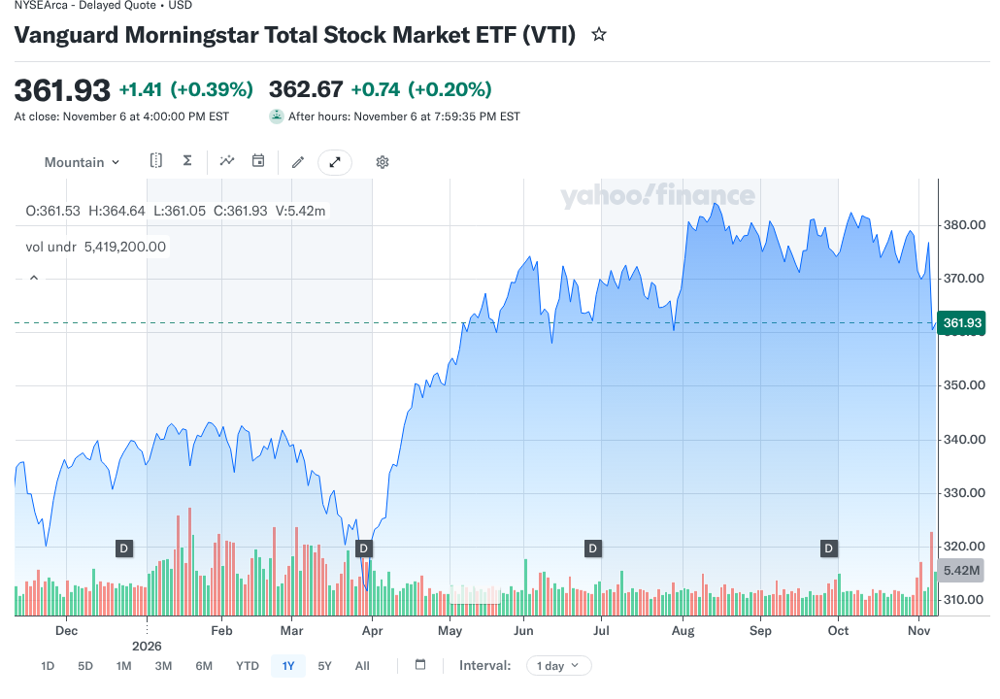
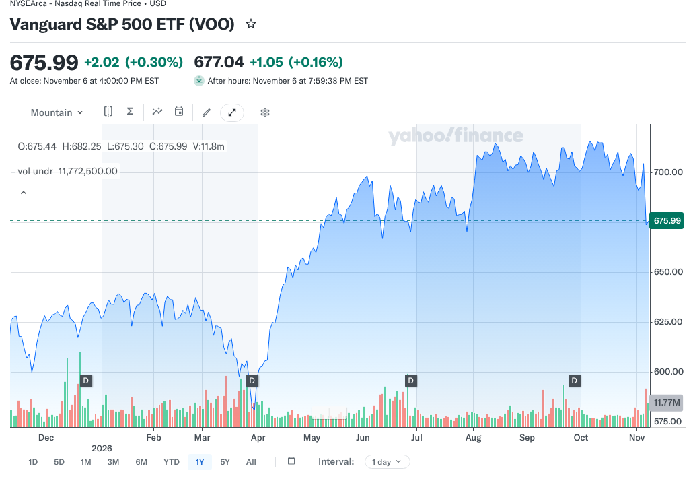

# VTI vs VOO in 2026: Total Market Coverage or the S&P 500?

A broad U.S. stock fund sounds like one of the easier investment decisions. Then two familiar tickers appear side by side, and the VTI vs VOO question begins. Both are Vanguard ETFs, both charge 0.03% a year, and their largest holdings are the same companies, so it is fair to wonder whether the choice makes any difference.

The answer depends less on recent performance than on which part of the market you want to own. VTI covers the whole U.S. stock market, including smaller companies. VOO covers the large companies in the S&P 500. Either can anchor long-term stock exposure, but owning both is not the same as adding a different asset. None of this is a recommendation to buy either fund.

## Key Takeaways

- VTI held 3,519 stocks and VOO held 505 on September 30, 2026, according to Vanguard's fact sheets.
- Both list a 0.03% expense ratio as of April 28, 2026, so cost does not separate them.
- Their top 10 holdings are the same companies, making up 36.1% of VTI and 40.6% of VOO.
- VTI adds small and mid-sized companies, but they are a modest share of its value.
- Neither fund adds international stocks or bonds, so owning both mainly doubles up on U.S. large companies.

## VTI vs VOO at a Glance

The table compares the two funds using Vanguard's own data. Holdings and weights are as of September 30, 2026, and they change over time.

| Question | VTI | VOO |
|---|---|---|
| Full name | Vanguard Morningstar Total Stock Market ETF | Vanguard S&P 500 ETF |
| Main exposure | The whole U.S. stock market | Large companies in the S&P 500 |
| Benchmark | Morningstar US Total Market Index | S&P 500 Index |
| Expense ratio | 0.03% (as of April 28, 2026) | 0.03% (as of April 28, 2026) |
| Number of stocks | 3,519 | 505 |
| Top 10 as share of assets | 36.1% | 40.6% |
| Fund launched | May 24, 2001 | September 7, 2010 |

The figures come from [Vanguard's VTI fact sheet](https://fund-docs.vanguard.com/F0970.pdf) and [VOO fact sheet](https://fund-docs.vanguard.com/F0968.pdf), both dated September 30, 2026, and from Vanguard's fund data for expense ratios and launch dates.

## Why Two Funds With Different Holding Counts Behave Alike

The number of stocks a fund owns is an incomplete measure of diversification. Both funds weight companies by market value, so the largest businesses carry most of the weight. VTI adds about 3,000 more stocks than VOO, but those extra companies are small next to the giants at the top.

The fact sheets show how similar the top of each fund is. The same 10 companies lead both: Nvidia, Apple, Microsoft, Alphabet, Amazon, Broadcom, Meta Platforms, Micron Technology, Tesla and Advanced Micro Devices.

| Company | Share of VTI | Share of VOO |
|---|---|---|
| Nvidia | 7.1% | 8.4% |
| Apple | 6.6% | 7.4% |
| Microsoft | 5.2% | 5.8% |
| Alphabet | 4.9% | 5.5% |
| Amazon | 3.3% | 3.7% |
| Broadcom | 2.3% | 2.5% |
| Meta Platforms | 2.2% | 2.4% |
| Micron Technology | 1.6% | 1.8% |
| Tesla | 1.4% | 1.5% |
| Advanced Micro Devices | 1.4% | 1.5% |

Nvidia, Apple and Microsoft alone add up to 18.9% of VTI and 21.6% of VOO. That is our sum of the fact-sheet weights, so a move in three stocks drives about a fifth of either fund.

Because these companies dominate both funds, a rally or sell-off led by a few large technology firms moves VTI and VOO together. The two funds have different names and indexes, but their main sources of return overlap.

### Coverage Versus Weight

A useful way to frame VTI vs VOO is coverage versus weight. VTI covers far more companies, while VOO puts its whole portfolio in the large-company segment. VTI does not split money equally across its 3,519 stocks, and VOO does not hold the smaller companies outside its index. The difference sits in the smaller-company slice. Dividing VTI's top-10 weight by VOO's (36.1 by 40.6) gives about 0.89, which suggests that roughly 11% of VTI sits outside the S&P 500. That is our estimate from the fact sheets, not a Vanguard figure, but it shows the slice is a minority rather than half the fund.

### Does Owning Both Add Diversification?

Some, but much less than the ticker count suggests. VTI already holds every company in VOO, so a portfolio split between the two still leans heavily toward U.S. large companies. Adding VOO to VTI raises the weight of S&P 500 stocks rather than adding an independent market. An investor who wants exposure to foreign companies needs an international fund, and one who wants stability needs bonds or cash, not a second U.S. index fund.

## How to Read the Numbers in a VTI vs VOO Fact Sheet

Vanguard publishes a fact sheet for each fund every quarter. Knowing what the main lines mean makes any VTI vs VOO comparison easier to check yourself, and it helps you spot when a website is quoting stale data.

### Holdings Count and Top-10 Weight

The holdings count tells you how many stocks the fund owns on the date shown. The top-10 weight tells you how much of the fund sits in its 10 biggest positions. Read them together. A large count with a high top-10 weight still means a concentrated fund, which is why 3,519 stocks in VTI do not spread risk evenly across thousands of companies.

### Sector Weights and the As-Of Date

Sector weights show which industries dominate. VOO's 39.7% in information technology on September 30, 2026 is a good example of how a market-value index tilts toward whatever has grown fastest. Always check the as-of date printed on the sheet. A quarter-old weight can drift by several points when a few large companies rise or fall sharply.

## What Do VTI and VOO Cost?

Vanguard lists the same 0.03% expense ratio for both funds as of April 28, 2026. On a $10,000 balance, that is about $3 a year at a constant balance, before market moves and any brokerage costs. On $100,000, it is about $30.

| Balance | Yearly cost at 0.03% |
|---|---|
| $5,000 | $1.50 |
| $25,000 | $7.50 |
| $50,000 | $15 |
| $250,000 | $75 |

These are illustrative calculations at a constant balance. Real costs move with the account value during the year, and the figures are identical for both funds.

Because the expense ratios match, choosing between them on fees alone gives no cost advantage. The more useful questions are tracking differences, bid-ask spreads when you trade, and the investments you hold around the fund.

An ETF trades on an exchange during market hours. The bid-ask spread is the gap between what buyers offer and what sellers ask, and a market order during a volatile moment may get a worse price than a patient limit order. For someone making occasional purchases, that cost is usually tiny, but the expense ratio is not the only possible trading cost.

## Which Fund Holds More Small and Mid-Sized Companies?

VTI. Its total-market mandate includes companies too small to qualify for the S&P 500. That gives direct exposure to a part of the market that can behave differently from large companies over some periods.

It does not guarantee better returns. Smaller companies can be less profitable, less liquid, more sensitive to the economy and more volatile. They may lead in one period and lag in another. VTI captures those swings alongside large-company returns, while VOO leaves that segment out.

VOO is still a diversified large-company fund, not a single-sector bet. The S&P 500 spans many industries. But Vanguard's fact sheet shows information technology at 39.7% of VOO on September 30, 2026, so large-company indexes can become concentrated when a few sectors grow fastest.

## Which Fund Fits Which Investor Goal?

A goal-first approach keeps the decision grounded. The two short profiles below describe common situations, not recommendations, and many investors could reasonably land on either fund.

### When Total-Market Breadth Is the Priority

Some investors want one fund to stand in for the entire U.S. stock market so they never have to decide which slice to own. VTI matches that aim because it includes small and mid-sized companies as well as the giants. The trade-off is a few thousand extra holdings that add little weight, so the fund still behaves mostly like large U.S. stocks.

### When an S&P 500 Benchmark Is the Priority

Other investors want their results to line up with the S&P 500, the index most often quoted in the news and in workplace plan reports. VOO tracks that index directly, which makes comparing your returns with the headline number simple. The trade-off is that it leaves out smaller companies entirely, so any period when they lead will not show up in the fund.

## A Simple Portfolio Example

Consider two hypothetical investors, each putting $20,000 into one U.S. stock ETF. These examples illustrate the structure, not expected returns.

- **Investor A:** Buys VTI and wants the entire U.S. stock market in one fund.
- **Investor B:** Buys VOO and prefers the established large-company segment.

At 0.03%, each fund's yearly expense is about $6 on an unchanged $20,000 balance. Their results will mainly differ when small and mid-sized stocks perform differently from large ones, with small extra gaps from index construction and tracking.

Neither investor gains international diversification from either fund. Both remain exposed to U.S. stock market losses, and neither is protected from a long bear market.

## Which Is Better in a Roth IRA or a Taxable Account?

Both can be held in a brokerage account or an IRA, and the account's tax rules apply to whichever you choose. Because both are ETFs from the same company, the usual comparison between ETFs and mutual funds does not apply here.

Inside an IRA, buying, selling and dividends are generally not taxed each year, which removes most tax differences between funds. In a taxable account, the more useful question is whether you need total-market breadth, a large-company focus, or a mix of other assets.

## Should You Switch From VOO to VTI, or the Reverse?

Not automatically. Selling a fund in a taxable account can trigger a capital gain, and the expected benefit of switching between two heavily overlapping funds is small. Before moving, check your tax lots, the possible tax bill, and whether the current fund already fits your plan.

For new contributions, a simpler path is to direct future purchases to the fund you prefer rather than selling an existing position. Also check whether your broker supports fractional ETF shares and recurring purchases, which help keep a plan consistent.

The appeal of a one-fund U.S. stock position is simplicity. A clear target mix, steady contributions and a portfolio with other assets where appropriate usually count for more than a small performance gap between two very similar index funds.

## Common Mistakes When Comparing the Two Funds

The first mistake is treating the holdings count as a safety score. A fund with thousands of stocks can still fall almost as far as a fund with 500 when the largest companies drop, because those companies carry most of the weight in both.

The second is reading a short return window as proof. A one-year chart shows which slice of the market led during that year, and the lead can reverse. The Yahoo charts shown above are context, not a forecast. A fund that trailed last year can lead the next one, and the reverse is just as common, so a single year says little about the decade ahead.

The third is quoting old data. Holdings, weights and sector mixes shift every quarter, and expense ratios can change. Check the as-of date before you rely on any number, including the ones here.

The fourth is assuming two U.S. funds make a complete portfolio. VTI and VOO both leave out international stocks and bonds, so a portfolio built from them alone still depends entirely on U.S. companies. Your time horizon, need for cash and tolerance for losses shape the rest of the mix far more than this choice does.

## VTI vs VOO Compared With Other Vanguard Choices

The VTI vs VOO choice sits beside two other common comparisons. One is VOO against SPY, another S&P 500 fund with a different structure and cost. FinLoom's comparison of [VOO vs SPY](/investing/voo-vs-spy/) covers that same-index decision.

The other is VOO against a growth fund such as VUG, which concentrates more heavily in fast-growing large companies. The comparison of [VUG vs VOO](/investing/vug-vs-voo/) shows how much more weight a growth tilt puts on the same top names.

## How to Decide Without Chasing Last Year's Winner

Compare each fund against a written goal. If you want broad U.S. stock ownership without leaving out smaller companies, VTI is the more direct fit. If you want to track the S&P 500 and stay within large companies, VOO is the direct fit.

Avoid choosing whichever fund led the performance chart most recently. Short return windows reflect which part of the market happened to lead, and say little about which will lead next. Stocks of any size can fall sharply, and FinLoom's comparison of [crypto vs stocks](/investing/crypto-vs-stocks/) shows how drawdowns and volatility differ across asset types. Confirm the current index, holdings and costs on Vanguard's pages before you decide.

## Frequently Asked Questions

### Is VTI Safer Than VOO?

Not necessarily. VTI owns more companies, including smaller ones, while VOO owns S&P 500 companies. Both are stock funds exposed to market losses and to concentration in large technology firms.

### Is VTI More Diversified Than VOO?

By holdings count, yes: 3,519 against 505 in September 2026. But both weight by market value and share a top 10, so the gain is smaller than it looks.

### Can I Own Both VTI and VOO?

Yes, but understand the overlap. VTI already holds every VOO company, so owning both mainly increases your weight in U.S. large companies rather than adding international or bond exposure.

### Do VTI and VOO Have the Same Expense Ratio?

Yes. Vanguard lists 0.03% for both as of April 28, 2026. Check the current prospectus before investing, because fund expense ratios can change over time.

### What Is the Main Difference in VTI vs VOO?

VTI tracks the whole U.S. stock market, including small and mid-sized companies, while VOO tracks the S&P 500. Their largest holdings and costs are almost identical.

## Resources

- [Vanguard: VTI fact sheet, September 30, 2026](https://fund-docs.vanguard.com/F0970.pdf)
- [Vanguard: VOO fact sheet, September 30, 2026](https://fund-docs.vanguard.com/F0968.pdf)
- [Vanguard: VTI fund profile](https://advisors.vanguard.com/investments/products/vti/vanguard-total-stock-market-etf)
- [Vanguard: VOO fund profile](https://advisors.vanguard.com/investments/products/voo/vanguard-sp-500-etf)
- [Yahoo Finance: VTI chart](https://finance.yahoo.com/quote/VTI/chart/)
- [Yahoo Finance: VOO chart](https://finance.yahoo.com/quote/VOO/chart/)

*Investing involves risk, including possible loss of principal. This comparison is educational and is not investment advice. Fund data and costs can change, so confirm them with Vanguard before investing.*
