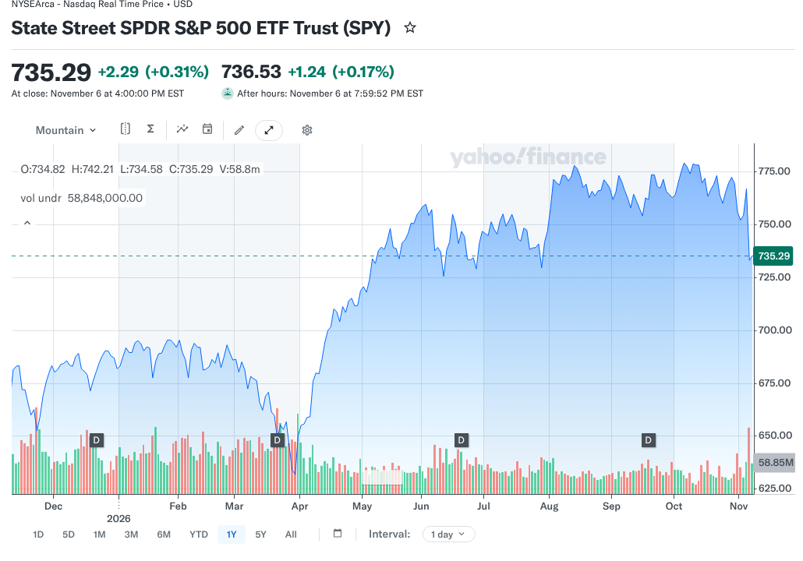
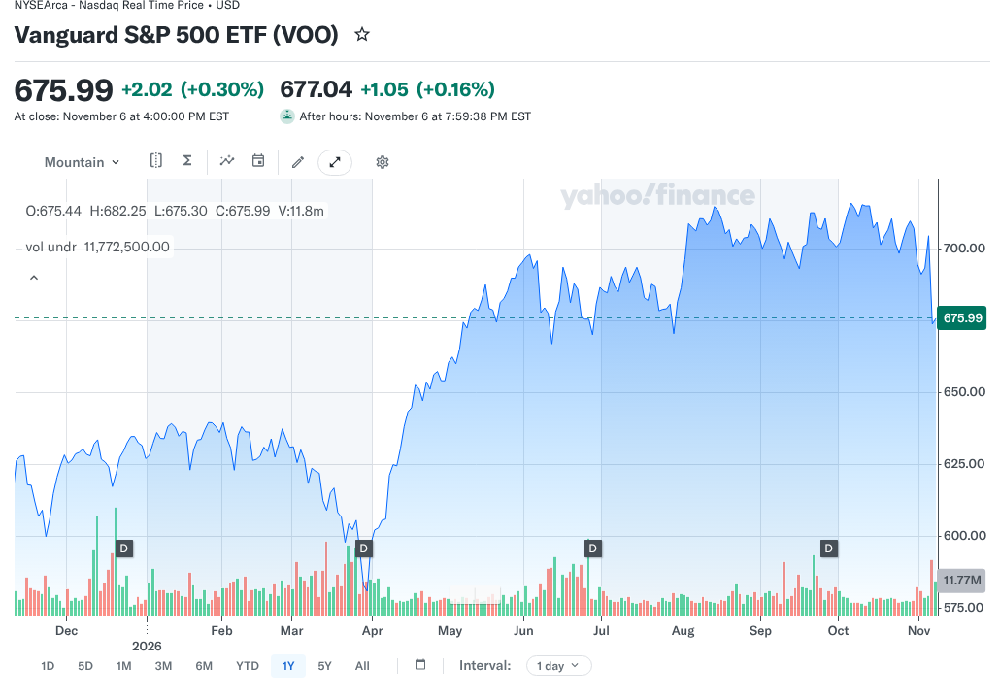

# VOO vs SPY in 2026: Same S&P 500, Different Costs and Structure

Two funds can follow the same index and still give investors a reason to compare them. That is the VOO vs SPY question in a sentence. Both ETFs aim to track the S&P 500, both hold roughly 500 of the same large U.S. companies, and both trade on an exchange all day.

The differences sit in cost, legal structure and how each fund tends to be used. VOO charges less each year. SPY is older, much larger by assets, and has a busy options market. Neither fact makes one fund a better investment for everyone, and nothing here is a recommendation to buy or sell either one.

## Key Takeaways

- VOO lists a 0.03% expense ratio as of April 28, 2026, while State Street lists a 0.0945% gross expense ratio for SPY.
- Both track the S&P 500. SPY held 504 stocks on November 5, 2026, and VOO held 505 on September 30, 2026.
- SPY listed on January 22, 1993. VOO launched on September 7, 2010.
- SPY is organized as a trust, while VOO is issued as Vanguard ETF Shares.
- Owning both mainly doubles up on the same companies rather than adding diversification.

## VOO vs SPY at a Glance

The table uses each issuer's own published data. The dates differ because each issuer updates its figures on its own schedule.

| Question | VOO | SPY |
|---|---|---|
| Full name | Vanguard S&P 500 ETF | SPDR S&P 500 ETF Trust |
| Issuer | Vanguard | State Street |
| Benchmark | S&P 500 Index | S&P 500 Index |
| Expense ratio | 0.03% (as of April 28, 2026) | 0.0945% gross |
| Number of holdings | 505 (September 30, 2026) | 504 (November 5, 2026) |
| Launch or listing date | September 7, 2010 | January 22, 1993 |
| Distribution frequency | Quarterly | Quarterly |
| Options available | Yes, through brokers that list them | Yes |

SPY's figures come from [State Street's SPY fund page](https://www.ssga.com/us/en/intermediary/etfs/state-street-spdr-sp-500-etf-trust-spy), fetched November 8, 2026. VOO's figures come from [Vanguard's VOO fact sheet](https://fund-docs.vanguard.com/F0968.pdf) dated September 30, 2026, and Vanguard's fund data.

## If Both Track the Same Index, Why Can Returns Differ?

An index is a calculation. A fund is a real portfolio that pays expenses, holds a little cash, receives dividends and adjusts when the index changes. Each of those steps creates small gaps between the fund and the index, and between two funds following the same index.

The biggest steady gap in VOO vs SPY is the expense ratio. A fund's expenses come out of its assets every day, so a higher fee lowers the fund's return by about that amount over a year, all else equal. Over short windows, timing differences in dividends and cash can show up too.

### Price Return Versus Total Return

A price chart leaves out dividends. A total-return comparison assumes dividends are reinvested. If one source shows price return for one fund and total return for the other, two nearly identical portfolios can look far apart. A fair comparison uses the same start date, end date and dividend treatment for both funds.

### Why Holdings Counts Differ Slightly

The S&P 500 has about 500 companies, but some companies issue more than one class of shares, so the count of stocks can sit a little above 500. Snapshot dates also differ. Vanguard's figure is a quarter-end count, while State Street's is a recent daily count, so a one-stock gap says nothing about which fund is broader.

## What Does the Expense Ratio Gap Cost in Dollars?

VOO's 0.03% is lower than SPY's 0.0945%. The gap is 0.0645 percentage points a year, or 6.45 basis points. The table shows what that means at a few balances, assuming the balance stays the same all year.

| Balance | VOO at 0.03% | SPY at 0.0945% | Difference |
|---|---|---|---|
| $10,000 | $3.00 | $9.45 | $6.45 |
| $50,000 | $15.00 | $47.25 | $32.25 |
| $100,000 | $30.00 | $94.50 | $64.50 |
| $500,000 | $150.00 | $472.50 | $322.50 |

These are illustrative calculations, not forecasts. Real expenses are taken from fund assets as they change through the year, not billed separately. Trading spreads, account fees and taxes are not included.

At small balances the gap is a few dollars a year. At large balances held for many years it adds up, which is why cost-focused, long-term index investors pay close attention to expense ratios. Over 20 years at an unchanged $100,000 balance, the simple difference would be about $1,290 before any growth, and more once growth is included.

## Why Might an Active Trader Still Use SPY?

SPY has the longest trading history of the two and is far larger by assets. State Street reported about $777.7 billion in SPY on November 5, 2026. Its page also confirms that options are available. Traders who buy and sell often, or who use options, may value that activity more than a small yearly fee.

For a trader, the costs that count are the ones paid on each trade: the bid-ask spread, the price impact of a large order and option pricing. These change minute to minute. They can widen at the market open, around big news or when stocks are volatile, so the only reliable check is a live quote at the time of the trade.

### A Hypothetical Trading-Cost Example

Suppose a trader's total execution costs on one round trip differ by $10 between two funds because of spreads. On a $10,000 position held for a week, that $10 is larger than a full year's fee gap of $6.45. In that case, trading costs drive the decision. This is a hypothetical example, not a measured spread for either fund.

### A Hypothetical Long-Term Example

Now take a $100,000 position held for five years with no trades after the first purchase. The yearly fee gap is about $64.50 at that balance, so the simple difference is about $322.50 over five years before growth. Here the one-time trading cost fades and the recurring expense ratio becomes the main cost difference. This is also an illustrative calculation.

## Is SPY Structured Differently From VOO?

Yes. SPY is organized as a unit investment trust, as its name, SPDR S&P 500 ETF Trust, suggests. State Street's page lists a trustee and a sponsor rather than a typical fund board structure. VOO is issued as Vanguard ETF Shares, which its fact sheet says are bought and sold on the market rather than redeemed with the fund, except in very large blocks.

For most buy-and-hold investors, the structure is a background detail. The shared index, the cost and the ease of buying through a brokerage usually count for more. Investors with complex strategies, or who depend on precise distribution timing, should read each fund's prospectus rather than assume every feature works the same way.

SPY's age explains much of its role in trading. A long record and a large, active market tend to attract more traders. That history says nothing about future returns, which depend on the S&P 500 itself and each fund's costs.

## Are the Holdings the Same?

They are designed to be. Both funds track the S&P 500, which State Street describes as a float-adjusted, market-value-weighted index of large U.S. companies across all eleven sectors. The same giant companies lead both funds. Vanguard's fact sheet shows Nvidia at 8.4% and Apple at 7.4% of VOO on September 30, 2026.

Neither fund holds U.S. small and mid-sized companies outside the index. If broader coverage is the goal, FinLoom's comparison of [VTI vs VOO](/investing/vti-vs-voo/) shows how a total-market fund differs from an S&P 500 fund. Owning both VOO and SPY mainly doubles the same exposure. Three S&P 500 tickers are still one source of stock market risk.

## What Owning the S&P 500 Means in Practice

Because both funds hold the same index, the portfolio you get is the same story either way. The S&P 500 weights companies by market value, so the largest firms dominate. Vanguard's fact sheet shows VOO's top 10 holdings at 40.6% of assets on September 30, 2026, and information technology at 39.7%.

That concentration is the real risk driver in both funds. When a handful of large technology companies rise, VOO and SPY rise together. When those companies fall, both funds fall together, and the fee gap does nothing to soften it. Choosing between the two tickers does not change this exposure.

It also explains why the two charts in this comparison look almost identical. The lines differ only by small amounts tied to costs and timing, not by any difference in strategy. Anyone expecting one fund to behave very differently from the other in a sell-off will be disappointed. The more useful question is how much of your total portfolio belongs in large U.S. stocks at all, since that choice shapes your results far more than the ticker you use to get there.

## How to Check the VOO vs SPY Numbers Yourself

Figures in any comparison go out of date. A few minutes on each issuer's site confirms the current picture, and the same habit works for any pair of index funds.

### Check the Issuer Pages

Open State Street's SPY page and Vanguard's VOO page or fact sheet. Note the expense ratio, the holdings count and the date printed next to each figure. If a website quotes a fee that does not match the issuer, trust the issuer. Also confirm the benchmark, since both should name the S&P 500 Index.

### Check a Live Quote Before You Trade

If you plan to trade, look at the live bid and ask prices for each fund in your brokerage account. The gap between them is the spread you pay on a market order. A limit order lets you set the most you will pay. Spreads change through the day, so check at the time you plan to act.

## What About Dividends and Taxes?

Both funds pass along dividends from the companies they hold, and both distribute quarterly. Amounts and dates differ between the two, so a headline yield at one moment is a weak basis for comparison. Total return, which includes reinvested dividends, gives a clearer picture.

In an IRA or another tax-advantaged account, yearly dividends and trades are generally not taxed as they happen. In a taxable account, dividends are generally taxable in the year received, and selling a fund can trigger a capital gain. Your own tax result depends on the account, holding period and cost basis.

### Switching Between the Two

Selling SPY to buy VOO, or the reverse, can create a taxable gain in a regular brokerage account. On a $50,000 position, the yearly fee gap is about $32 at an unchanged balance, so a tax bill from switching could take many years of fee savings to recover. Directing new money to the fund you prefer avoids selling.

### Holding Them in Retirement Accounts

Inside an IRA, switching between the two does not usually create a tax bill, so the fee gap becomes the main difference for a long-term holder. Before acting, check whether your broker charges anything to trade either fund and whether it supports recurring purchases or fractional shares, which make regular investing easier.

## Which Fund Fits Which Investor?

Start with how you plan to use the fund. For regular purchases held for years, VOO's lower expense ratio is a clear, measurable advantage, since the two funds own the same index. If you trade often or use options, SPY's large and active market may match how you work, and you can check live quotes and option chains before deciding.

The VOO vs SPY choice also sits beside a third common S&P 500 option. Fidelity's mutual fund FXAIX tracks the same index with a different structure and cost, and FinLoom's comparison of [FXAIX vs VOO](/investing/fxaix-vs-voo/) covers that decision. Any of these can serve as a core S&P 500 holding when costs and account type fit your plan.

Whatever you choose, remember that an S&P 500 fund is still a stock investment. It can fall sharply in a bear market. FinLoom's comparison of [crypto vs stocks](/investing/crypto-vs-stocks/) shows how volatility and drawdowns differ across asset types, which helps when setting how much of a portfolio to keep in stocks at all.

## Common Mistakes in the VOO vs SPY Debate

The first mistake is comparing returns that use different dividend treatment or dates. The second is assuming a fund with an older history will keep outperforming a newer one with the same holdings. Since the portfolios are nearly identical, the expected difference over time comes mostly from costs.

The third is treating the expense ratio as the only cost for a frequent trader, or treating trading costs as decisive for someone who buys once a month and holds. The right cost to focus on depends on how often you trade. The fourth is quoting stale fees. Expense ratios can change, so confirm the current figure on each issuer's page before you decide.

The fifth is overlooking the account itself. Some brokers support recurring investments or fractional shares for one fund but handle the other differently, and some charge fees that dwarf a 6.45 basis point gap. Checking how your own account handles each ticker can settle the question faster than any fund comparison, because the funds themselves are so close.

## Frequently Asked Questions

### Is VOO Better Than SPY?

For long-term holders, VOO has the lower expense ratio, 0.03% against SPY's 0.0945%. SPY may suit frequent traders who value its large options market. Neither promises better future returns.

### Is SPY Riskier Than VOO?

Not in any meaningful way. Both track the S&P 500 and hold the same large companies, so both carry the same stock market risk, including the chance of large losses.

### Do VOO and SPY Pay Dividends?

Yes. Both pass along dividends from their holdings and distribute quarterly. Amounts and dates differ, so compare total returns with dividends reinvested rather than a single headline yield.

### Should I Own VOO and SPY Together?

Owning both adds little because they track the same index. It mostly doubles the same companies. A different asset class or market segment would add more diversification to a portfolio.

### What Is the Expense Ratio Difference in VOO vs SPY?

VOO lists 0.03% and SPY lists 0.0945% gross, a gap of 6.45 basis points. On an unchanged $10,000 balance, that is about $6.45 a year.

## Resources

- [State Street: SPY fund page](https://www.ssga.com/us/en/intermediary/etfs/state-street-spdr-sp-500-etf-trust-spy)
- [Vanguard: VOO fact sheet, September 30, 2026](https://fund-docs.vanguard.com/F0968.pdf)
- [Vanguard: VOO fund profile](https://advisors.vanguard.com/investments/products/voo/vanguard-sp-500-etf)
- [Yahoo Finance: SPY chart](https://finance.yahoo.com/quote/SPY/chart/)
- [Yahoo Finance: VOO chart](https://finance.yahoo.com/quote/VOO/chart/)

*Investing involves risk, including possible loss of principal. This comparison is educational and is not investment advice. Fund data and costs can change, so confirm them with each issuer before investing.*
