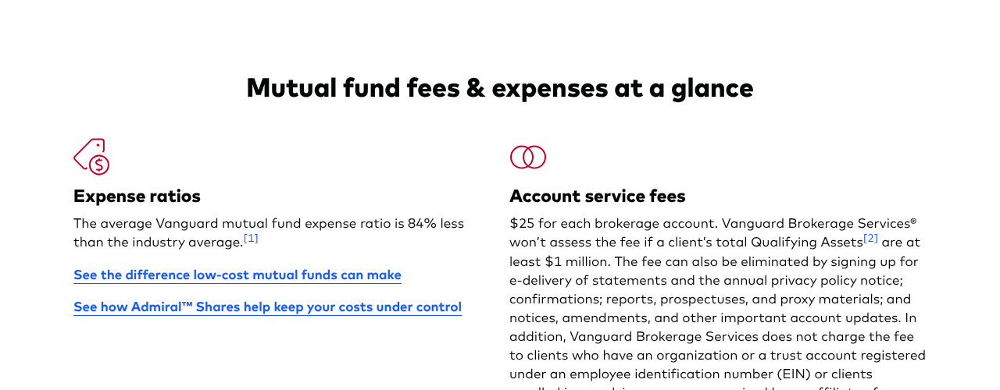

# Fidelity vs Vanguard in 2026: Fees, Funds, Minimums and Account Fit

Fidelity and Vanguard are two of the best-known names in long-term investing, and both let you build a low-cost index portfolio. That makes the Fidelity vs Vanguard choice less about which brand is better and more about which account fits the way you invest.

The two firms differ in account fees, fund minimums, what they charge to buy outside mutual funds and how their own index funds are built. This comparison uses each firm's own published fee pages, checked in November 2026. It is not a recommendation to open an account with either firm.

Below you will find a side-by-side fee table, the exact conditions for Vanguard's account fee, the minimums for each firm's index funds, the cost of buying another company's mutual funds and two worked examples. Each figure links back to the firm's own page so you can confirm it before deciding.

## Key Takeaways

- Both firms list $0 commissions for online ETF trades, and Fidelity lists $0 for online U.S. stock trades too.
- Vanguard charges a $25 fee for each brokerage account, waived with e-delivery, $1 million in qualifying assets or certain account types.
- Fidelity lists no minimum to open an account. Most Vanguard index mutual funds require $3,000.
- Fidelity charges $49.95 per purchase of transaction-fee non-Fidelity funds.
- Choosing a broker and choosing a fund are separate decisions. Many ETFs trade at either firm.

## Fidelity vs Vanguard at a Glance

The table uses each firm's fee pages, fetched November 6 to 9, 2026. Fees change, so confirm them before opening an account.

| Question | Fidelity | Vanguard |
|---|---|---|
| Online U.S. stock and ETF commissions | $0 | $0 for ETFs; stocks per fee schedule |
| Options | $0 commission, $0.65 per contract | Per Vanguard fee schedule |
| Account minimum | None to open an account | Fund minimums apply to mutual funds |
| Annual brokerage account fee | None listed on commission page | $25 per account, with waivers |
| Index mutual fund minimum | FXAIX $0 | $3,000 for most index funds |
| Outside mutual funds | $0 for NTF funds; $49.95 per purchase for transaction-fee funds | Funds from other companies available, fees vary |
| Example S&P 500 fund | FXAIX, 0.015% | VOO, 0.03% |

Fidelity's figures come from [Fidelity's commissions and fees page](https://www.fidelity.com/trading/commissions). Vanguard's figures come from [Vanguard's mutual fund fees and minimums page](https://investor.vanguard.com/investment-products/mutual-funds/fees).

## Brokerage Choice and Fund Choice Are Separate

You can like Vanguard's funds without holding your account at Vanguard, and the reverse. ETFs trade on exchanges, so many Vanguard ETFs can be bought in a Fidelity account and many Fidelity ETFs in a Vanguard account, subject to each broker's rules. The broker sets the account features. The fund company sets the fund's costs.

Mutual funds are different. Each firm makes its own funds easiest to buy, and buying another company's mutual funds can come with transaction fees or limits. That is where the Fidelity vs Vanguard choice can change your costs.

### Why Mutual Funds Change the Math

Fidelity's fee page lists $0 to buy No Transaction Fee non-Fidelity funds, but a $49.95 redemption fee if they are held less than 60 days. Transaction-fee non-Fidelity funds cost $49.95 per purchase, and Fidelity notes certain funds can carry a fee up to $100. Someone buying a Vanguard mutual fund every month at Fidelity would want to check which category it falls in.

### Why ETFs Simplify It

Both firms list $0 online commissions for ETFs. If your plan uses ETFs, the account you choose has less effect on trading costs, and you can focus on features, service and any account fees. That is one reason many investors who want funds from both companies hold ETFs.

## What Does Each Firm Charge?

The headline commissions look alike, so the details carry the difference. Below are the fees most long-term investors are likely to meet.

### Vanguard's $25 Account Service Fee

Vanguard's fee page lists a $25 fee for each brokerage account. It is not charged if your total qualifying assets are at least $1 million. It can also be eliminated by signing up for e-delivery of statements, confirmations, reports, prospectuses and other account documents. Vanguard also does not charge it for organization or trust accounts registered under an EIN, or for clients in an advisory program serviced by a Vanguard affiliate.

For most people, choosing e-delivery removes the fee. It would be wrong to assume every Vanguard customer pays $25, and equally wrong to assume nobody does.

### Fidelity's Fee Schedule

Fidelity's commissions page lists $0 for online U.S. stock, ETF and option trades, with a $0.65 fee per options contract, and no minimum to open an account. Fidelity also offers fractional shares. Trades placed with a representative and some bond trades carry separate charges, which the page details.

## Costs Beyond the Headline Commission

A $0 commission does not mean an account is free. The Fidelity vs Vanguard comparison changes once you count the smaller charges that show up in fee schedules.

### Short-Term Redemption and Assisted Trades

Fidelity charges $49.95 to redeem a No Transaction Fee non-Fidelity fund held less than 60 days. Its page also lists a $19.95 charge for Treasury auction orders placed with a representative, and a $19.95 minimum mark-up or mark-down on bonds traded with a representative. Investors who trade online and hold funds for months may never meet these fees.

### Fund Expenses Inside the Account

The largest long-term cost is often the expense ratio of the funds you hold, not the broker's fees. A fund charging 0.50% costs $500 a year on $100,000, while one charging 0.03% costs $30, both at an unchanged balance. Choosing low-cost funds usually saves more than choosing between two brokers with $0 commissions.

## How Do Their Index Funds Compare?

Each firm's flagship S&P 500 fund shows how close the two have become on cost. [Fidelity's FXAIX fact sheet](https://institutional.fidelity.com/app/proxy/content?literatureURL=%2F770893.PDF) lists a 0.015% expense ratio and a $0 minimum. Vanguard lists 0.03% for VOO, its S&P 500 ETF.

| Balance | FXAIX at 0.015% | VOO at 0.03% | Yearly difference |
|---|---|---|---|
| $10,000 | $1.50 | $3.00 | $1.50 |
| $50,000 | $7.50 | $15.00 | $7.50 |
| $100,000 | $15.00 | $30.00 | $15.00 |

These are illustrative calculations at an unchanged balance. They compare two specific funds, not the two firms' entire lineups. Both firms offer funds with higher costs, including actively managed funds. FinLoom's comparison of [FXAIX vs VOO](/investing/fxaix-vs-voo/) covers the mutual fund versus ETF trade-off between these two funds in detail.

### Minimums for Mutual Funds

Vanguard's fee page lists a $3,000 minimum for most index funds and most actively managed funds, and $1,000 for Target Retirement Funds and the STAR Fund. Those minimums apply to individual, joint, IRA, custodial and most other account types. FXAIX lists a $0 minimum. For someone starting with a small amount, that difference can decide which fund is practical.

### Vanguard's Cost Claim

Vanguard's fee page states that its average mutual fund expense ratio is 84% less than the industry average. That is Vanguard's own figure, footnoted on its page, not an independent measurement. It describes Vanguard's lineup on average, not any single fund you might choose.

## Research Tools and Account Experience

The two firms present themselves differently. Fidelity's public pages emphasize trading tools, research and a broad brokerage platform. Vanguard's pages center on fund investing and advice services. Neither approach is better for everyone. The right one depends on what you plan to do in the account.

A practical test is to try the same tasks at each firm before committing. Find a fund's expense ratio and holdings, check its dividend schedule and set up a recurring purchase. If those steps are easy, the account is likely to support steady investing. If you expect to research individual stocks often, deeper screening and trading tools may count for more. FinLoom's guide to the [best investment apps](/investing/best-investment-apps/) compares Fidelity with other platforms on features and fees.

## IRAs and Account Transfers

Both firms offer traditional and Roth IRAs. The tax rules, contribution limits and eligibility come from federal law, not the broker, so the Fidelity vs Vanguard choice does not change how much you can contribute. What differs is the fees, fund minimums and the ease of buying the funds you want inside the account.

### Moving an IRA

If you move an IRA, use a direct trustee-to-trustee transfer rather than withdrawing cash, which can trigger taxes and penalties. Ask the receiving firm which holdings can move in kind. A fund that the new broker does not hold may have to be sold and replaced.

### Moving a Taxable Account

In a regular brokerage account, selling a fund to move it can trigger a capital gains tax. ETFs generally transfer more easily between brokers than proprietary mutual funds. Before moving, compare the tax cost with the fee savings, which are often small. If the funds you hold are available at both firms, keeping the account where it is and changing only future contributions can avoid the tax entirely while still moving toward the setup you prefer.

## Two Hypothetical Investors

These profiles show how the comparison can play out. They are illustrations, not recommendations.

### Investor A Starts Small

Investor A has $500 to start and wants to invest $100 a month in an S&P 500 index fund. At Fidelity, FXAIX's $0 minimum lets Investor A begin right away. At Vanguard, Investor A could buy VOO, using fractional shares if the account supports them, since most Vanguard index mutual funds need $3,000. Either can work, but the mechanics differ.

### Investor B Holds Several Accounts

Investor B already holds over $1 million across accounts and mostly uses Vanguard funds. At Vanguard, the $25 account fee would not apply at that asset level, and the funds are native to the platform. Investor B might still compare service and tools at Fidelity, but the fund lineup and fee waiver make staying put simple.

## How to Compare Fidelity vs Vanguard Yourself

Fee pages change, and your situation is specific. A short checklist helps you test both firms against your own plan.

### List Your Funds First

Write down the exact funds or ETFs you want to hold. For each, check whether it is a mutual fund or an ETF, its expense ratio and its minimum. Then look up whether each broker charges a transaction fee for it. This step alone often settles the choice.

### Read the Fee Pages Directly

Open Fidelity's commissions page and Vanguard's fees page. Note the account service fee, any waivers you qualify for and the charges for outside funds. Check the date you read them. If a review site quotes a different figure, trust the firm's own page.

## Common Mistakes in the Fidelity vs Vanguard Choice

The first mistake is comparing one flagship fund and concluding one firm is cheaper overall. Both firms offer many funds at many costs. The second is ignoring the $25 Vanguard fee, or assuming it always applies, when e-delivery removes it for most people.

The third is buying another firm's mutual funds without checking transaction fees, which at Fidelity can be $49.95 per purchase. The fourth is switching brokers for a small fee gap and paying a larger tax bill in a taxable account. Your fund choice, contribution habit and overall mix usually count for more than the broker's name. A fifth mistake is choosing a firm for a feature you will rarely use. Advanced trading tools add little for someone who buys one index fund a month, while a missing fund or a high minimum can block a plan from the start.

## Service, Advice and Managed Options

Both firms offer more than self-directed accounts. Vanguard's fee page notes that the $25 fee is not charged to clients enrolled in an advisory program serviced by a Vanguard affiliate, which shows advice services are part of its lineup. Fidelity offers managed options as well, including its Fidelity Go robo-advisor, covered in FinLoom's app comparison.

Managed accounts usually charge an advisory fee on top of fund expenses, so compare the total yearly cost, not just the fund fees. If you want help choosing and rebalancing investments, that fee may be worth weighing. If you plan to buy a few index funds and hold them, a self-directed account at either firm keeps costs lower.

Customer service needs differ too. Some investors want phone support and in-depth research. Others want a simple interface and a short list of funds. Trying each firm's site before opening an account, without entering personal details, is a low-cost way to see which experience suits you.

## Which Firm Fits Which Investor?

Start with the exact funds you plan to hold. If you want Fidelity index mutual funds with no minimum, or a platform with broad trading and research tools, Fidelity is the natural home. If you want Vanguard mutual funds, especially Admiral Shares that Vanguard says start at $3,000 for 43 index funds, Vanguard is the natural home, and e-delivery removes the account fee.

If you plan to use ETFs, either firm can work, and service and features can decide. Whichever account you choose, the investments inside it still carry market risk. FinLoom's comparison of [crypto vs stocks](/investing/crypto-vs-stocks/) shows how volatility and drawdowns differ across asset types, which helps when deciding how much to invest in stocks at all.

## Frequently Asked Questions

### Is Fidelity Cheaper Than Vanguard?

It depends on the funds. FXAIX costs 0.015% against VOO's 0.03%, but both firms offer many funds. Account fees and outside fund charges also affect your total cost.

### Does Vanguard Charge an Annual Account Fee?

Yes, $25 per brokerage account. Vanguard waives it with e-delivery, $1 million in qualifying assets, certain trust or organization accounts, or enrollment in an affiliated advisory program.

### Can I Buy Vanguard ETFs at Fidelity?

Generally yes. ETFs trade on exchanges, and Fidelity lists $0 online ETF commissions. Check the order preview, since broker rules and fees for specific products can vary.

### What Are the Minimums at Each Firm?

Fidelity lists no minimum to open an account, and FXAIX has a $0 minimum. Vanguard lists $3,000 for most index mutual funds and $1,000 for Target Retirement Funds.

### Is Fidelity or Vanguard Better for a Roth IRA?

Both offer Roth IRAs under the same federal rules. Compare fund minimums, account fees and the funds you want, since the broker does not change contribution limits.

## Resources

- [Fidelity: Commissions and fees](https://www.fidelity.com/trading/commissions)
- [Vanguard: Mutual fund fees and minimums](https://investor.vanguard.com/investment-products/mutual-funds/fees)
- [Fidelity: FXAIX fact sheet, September 30, 2026](https://institutional.fidelity.com/app/proxy/content?literatureURL=%2F770893.PDF)
- [Vanguard: VOO fact sheet, September 30, 2026](https://fund-docs.vanguard.com/F0968.pdf)

*Investing involves risk, including possible loss of principal. This comparison is educational and is not investment advice. Fees and minimums can change, so confirm them with each firm before opening an account.*
