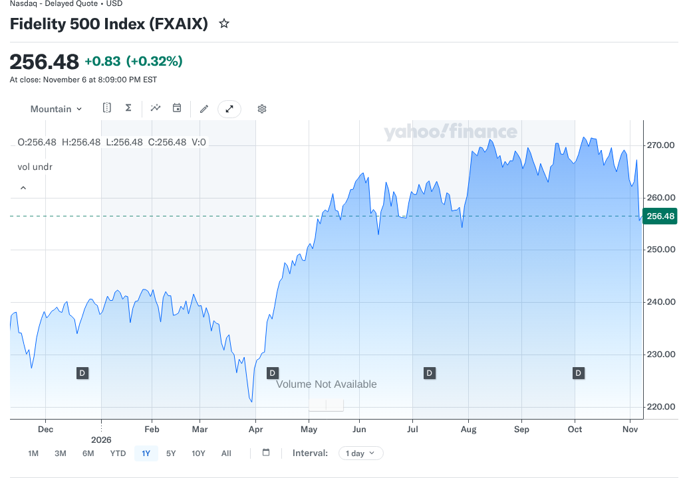
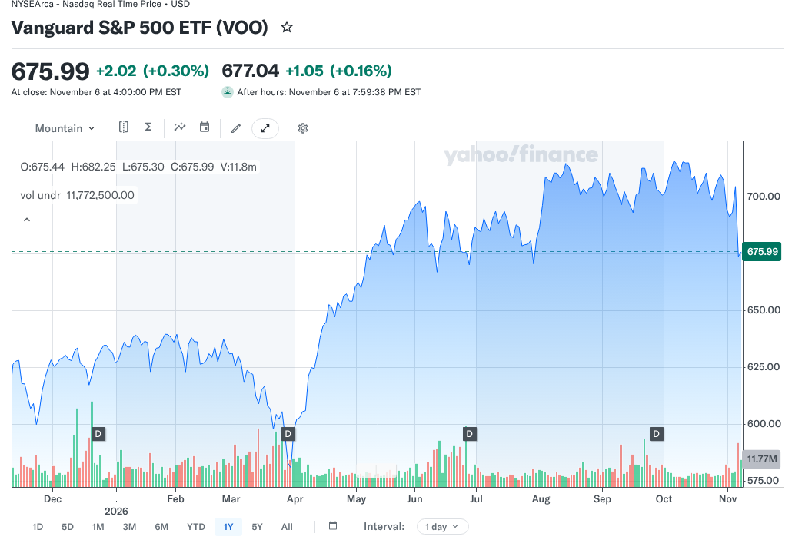

# FXAIX vs VOO in 2026: Fidelity Mutual Fund or Vanguard ETF?

You can own nearly the same group of large U.S. companies through two products that behave differently when you buy or sell them. That is the heart of the FXAIX vs VOO question. Fidelity's FXAIX and Vanguard's VOO both track the S&P 500, but FXAIX is a mutual fund and VOO is an exchange-traded fund.

Because the holdings are so close, the choice usually depends on where your account lives, how you contribute and whether you might move brokers later. A prediction about which fund will perform better is a weak basis for it. Nothing here is a recommendation to buy or sell either fund.

## Key Takeaways

- FXAIX lists a 0.015% expense ratio and VOO lists 0.03%, a gap of 1.5 basis points a year.
- FXAIX has a $0 minimum initial investment, according to its September 30, 2026 fact sheet.
- FXAIX trades once a day at its net asset value, while VOO trades on an exchange all day.
- Both are concentrated: the top 10 holdings were 39.03% of FXAIX and 40.6% of VOO on September 30, 2026.
- ETFs can be more tax efficient in taxable accounts, but that edge largely disappears inside an IRA.

## FXAIX vs VOO at a Glance

The table uses each issuer's own fact sheet, both dated September 30, 2026.

| Question | FXAIX | VOO |
|---|---|---|
| Full name | Fidelity 500 Index Fund | Vanguard S&P 500 ETF |
| Fund type | Mutual fund | Exchange-traded fund |
| Benchmark | S&P 500 Index | S&P 500 Index |
| Expense ratio | 0.015% | 0.03% (as of April 28, 2026) |
| Minimum initial investment | $0 | Price of one share, or less where a broker offers fractional shares |
| Holdings | 508 positions | 505 stocks |
| Top 10 as share of assets | 39.03% | 40.6% |
| Launch date | February 17, 1988 | September 7, 2010 |

FXAIX figures come from [Fidelity's FXAIX fact sheet](https://institutional.fidelity.com/app/proxy/content?literatureURL=%2F770893.PDF). VOO figures come from [Vanguard's VOO fact sheet](https://fund-docs.vanguard.com/F0968.pdf) and Vanguard's fund data.

## How Can the Same Index Feel So Different?

The S&P 500 is a list of large U.S. companies weighted by market value. Both funds aim to match it, so their portfolios look almost the same. What differs is the wrapper, meaning the legal and trading form the investment takes.

A mutual fund sells and redeems shares at one price per day, its net asset value, calculated after the market closes. An ETF trades on an exchange like a stock. [FINRA's guide to exchange-traded products](https://www.finra.org/investors/investing/investment-products/exchange-traded-funds-and-products) explains that ETF shares can be bought or sold throughout the trading day at changing prices and are subject to bid-ask spreads.

For someone investing $200 every payday for retirement, these differences may barely register. For someone who wants to set a limit price or move an account to another broker, they count for more.

### What Stays the Same

Neither wrapper changes the stock market risk. Both funds fall when large U.S. stocks fall, and both carry the same concentration in a few giant companies. Fidelity's fact sheet shows information technology at 39.68% of FXAIX, and Vanguard's shows 39.7% for VOO, both on September 30, 2026.

### What Changes

The wrapper shapes how you buy, what you pay beyond the expense ratio, how taxes can work in a regular brokerage account and how easily you can transfer the position. Those practical details are where the FXAIX vs VOO choice is usually decided, far more than the small gap in yearly fees.

## What Does the Fee Difference Save?

FXAIX's 0.015% is half of VOO's 0.03%. The gap is 0.015 percentage points, or 1.5 basis points a year. The table shows the yearly cost at a few balances, assuming the balance does not change.

| Balance | FXAIX at 0.015% | VOO at 0.03% | Yearly difference |
|---|---|---|---|
| $10,000 | $1.50 | $3.00 | $1.50 |
| $50,000 | $7.50 | $15.00 | $7.50 |
| $100,000 | $15.00 | $30.00 | $15.00 |
| $500,000 | $75.00 | $150.00 | $75.00 |

These are illustrative calculations. Real fund expenses come out of assets as they change during the year. Transaction fees, taxes and market moves are not included.

The amounts are small. A single mutual fund transaction fee at another broker, or a tax bill from switching, could cost more than years of the fee gap. That is why the account usually decides this choice, not the expense ratio.

## What You Own in Either Fund

Fidelity's fact sheet adds detail that applies to both funds, since they track the same index. On September 30, 2026, the top 20 holdings made up 49.90% of FXAIX, so about half the fund sat in 20 companies. U.S. stocks were 99.58% of the fund, which means almost no international exposure.

The same fact sheet reports a three-year tracking error of 0.01 for FXAIX. Tracking error measures how closely a fund's returns follow its index. For an index fund, a low figure is the goal. It shows the fund is doing its job of matching the S&P 500, not trying to beat it.

These numbers explain why the FXAIX vs VOO decision rarely comes down to holdings. Both funds own the same concentrated slice of the U.S. market. The practical differences sit in cost, trading and account fit.

## How Mutual Fund Purchases Work

When you buy FXAIX, your order fills at the next calculated net asset value. You cannot place an intraday limit order on a mutual fund the way you can with a stock or ETF. Everyone who buys on the same day gets the same price.

That can make investing simpler. You choose a dollar amount, the purchase goes through at the day's price and there is no quote to watch. With a $0 minimum and dollar-based purchases, it is easy to invest a fixed amount every payday. Check your broker's rules for recurring purchases and fractional mutual fund shares.

The main limit is where the fund lives. FXAIX is easiest to use inside a Fidelity account. Other brokers may not offer it, or may charge a transaction fee to buy it. Confirm availability and fees before choosing it outside Fidelity.

## How ETF Purchases Work

VOO trades on an exchange during market hours. You see a bid and an ask price and can use a market order or, where supported, a limit order that caps what you pay. The price can differ slightly from the fund's net asset value because ETF shares trade between investors.

For small recurring contributions, fractional shares help. If your broker allows fractional VOO purchases, investing a fixed dollar amount works much like a mutual fund. If it does not, you may need to wait until you have enough cash for a full share.

The trading costs to watch are the bid-ask spread and any commission. FINRA notes that ETF market prices can sometimes deviate from the value of the underlying holdings, so a limit order can help during volatile moments.

## Do Mutual Funds and ETFs Get Taxed Differently?

In a regular brokerage account, they can. FINRA explains that, because of how they are structured, ETFs might reduce capital gains distributions and can be more tax efficient than similar mutual funds. That is a possibility, not a promise for every fund or every year. You still owe tax on gains when you sell and on dividends you receive.

### Inside an IRA or 401(k)

In tax-advantaged accounts, yearly distributions and trades are generally not taxed as they happen. That removes most of the tax argument for an ETF. Inside a Roth IRA, for example, the FXAIX vs VOO choice comes down mainly to availability, cost and how you prefer to contribute.

### Inside a Taxable Account

In a taxable account, the ETF wrapper's potential tax efficiency can count for more over many years. If you already hold FXAIX with gains, though, selling it to buy VOO can trigger a capital gains tax. A few dollars of yearly fee difference rarely justifies a large realized gain just to change wrappers.

## What Happens If You Change Brokers?

Portability is often the deciding factor. Some brokers do not hold another firm's mutual funds, or charge to buy or sell them. ETFs are generally easier to transfer between brokers, though each firm sets its own rules. Before moving, ask the receiving broker for its list of accepted holdings.

A position that cannot transfer in kind may have to be sold. In a taxable account, that can realize a gain or loss. Retirement accounts follow different transfer rules, and a direct transfer is not the same as withdrawing cash. If your current fund and broker already fit your plan, avoiding a move may cost the least.

FXAIX vs VOO is often a Fidelity vs Vanguard decision underneath. FinLoom's comparison of [Fidelity vs Vanguard](/investing/fidelity-vs-vanguard/) looks at the brokerages themselves, including account fees and trading costs.

## Two Hypothetical Investors

The examples below show how the same comparison can lead to different choices. They are illustrations, not recommendations, and they assume no change in market value.

### Investor A Uses a Fidelity IRA

Investor A contributes $300 a month to a Roth IRA at Fidelity and never plans to move it. FXAIX fits this routine because the minimum is $0 and each $300 purchase goes in at the day's price. Inside the Roth IRA, the ETF tax advantage mostly does not apply, so the lower expense ratio is the remaining difference. On a $50,000 balance, that difference is about $7.50 a year.

### Investor B Uses Another Broker

Investor B holds a taxable brokerage account at a firm that is not Fidelity and may switch brokers in a few years. VOO fits this situation because ETFs generally transfer more easily, and FINRA notes their structure can reduce capital gains distributions. If the broker supports fractional shares, Investor B can still invest a set dollar amount each month.

## How to Check the FXAIX vs VOO Numbers Yourself

Fund data changes, so confirm it before you act. The same steps work for any mutual fund and ETF pair.

### Read Both Fact Sheets

Open Fidelity's FXAIX fact sheet and Vanguard's VOO fact sheet. Compare the expense ratio, the benchmark and the as-of date on each. If a website shows different figures, trust the issuer. Check the minimum initial investment too, since mutual fund minimums vary by fund.

### Check Your Broker's Fees

Look up whether your broker charges a transaction fee to buy FXAIX or a commission to trade VOO. Check whether it supports recurring purchases and fractional shares for each one. These account-level details often decide the choice faster than any fund-level comparison.

## Which Fund Fits Which Account?

Both can provide low-cost S&P 500 exposure. If you already invest through a Fidelity account and like automatic dollar-based purchases, FXAIX's $0 minimum and lower expense ratio make it a convenient fit. If you use another broker, want to keep the option to move or prefer to hold ETFs across your portfolio, VOO's exchange trading and portability may fit better.

FXAIX is not the only alternative to VOO. Another S&P 500 ETF, SPY, tracks the same index with a different structure and a higher fee. FinLoom's comparison of [VOO vs SPY](/investing/voo-vs-spy/) covers that decision for investors who want to stay with ETFs.

Neither fund adds international stocks, bonds or small companies. Both are stock investments that can fall sharply. FinLoom's comparison of [crypto vs stocks](/investing/crypto-vs-stocks/) shows how drawdowns and volatility differ across asset types, which helps when deciding how much belongs in stocks at all.

## Does Holding Both Funds Help?

Some investors end up with both funds, often because one sits in a workplace or Fidelity account and the other in a separate brokerage account. That is fine, but it is not diversification. Both funds hold the same S&P 500 companies in nearly the same weights, so owning both adds a second ticker, not a second source of return.

If you already hold both, there is usually no urgent reason to consolidate. Selling one in a taxable account can create a tax bill. Directing new money to whichever fund your main account handles best is a simpler way to tidy things up over time.

If the real goal is broader diversification, the useful additions are different kinds of investments, such as international stocks, smaller U.S. companies or bonds, depending on your time horizon and comfort with losses. A third S&P 500 fund would not change your exposure. Writing down a target mix first makes it easier to see which piece is missing before adding anything new.

## Common Mistakes in the FXAIX vs VOO Choice

The first mistake is treating the expense ratio as the whole cost. A transaction fee to buy a mutual fund at an outside broker can wipe out years of the 1.5 basis point gap. The second is switching in a taxable account to save a few dollars, which can create a much larger tax bill.

The third is assuming a mutual fund is safer because its price only changes once a day. The daily price hides intraday swings but not the market's moves. The fourth is forgetting future plans. If you might change jobs or brokers, portability can outweigh the small fee advantage of a mutual fund tied to one firm.

## Frequently Asked Questions

### Is FXAIX Cheaper Than VOO?

Its expense ratio is lower, 0.015% against 0.03%. Your total cost also depends on broker transaction fees, trading costs and taxes, which can easily outweigh that small gap.

### Can I Buy FXAIX Outside Fidelity?

Sometimes. Availability and fees vary by broker, and some charge a transaction fee for outside mutual funds. Confirm the exact fund and any costs with your broker before buying.

### Does VOO Pay Dividends?

Yes. Vanguard's fact sheet lists a quarterly dividend schedule for VOO. FXAIX also distributes income, so compare total returns with dividends reinvested rather than a headline yield.

### Is FXAIX Safer Because It Is a Mutual Fund?

No. Both track the S&P 500 and hold the same large companies. The wrapper changes how you trade, not your exposure to stock market losses.

### Which Is Better for a Roth IRA, FXAIX or VOO?

Inside a Roth IRA, tax differences between the wrappers mostly disappear. The choice depends on which fund your broker offers cheaply and how you prefer to contribute.

## Resources

- [Fidelity: FXAIX fact sheet, September 30, 2026](https://institutional.fidelity.com/app/proxy/content?literatureURL=%2F770893.PDF)
- [Vanguard: VOO fact sheet, September 30, 2026](https://fund-docs.vanguard.com/F0968.pdf)
- [Vanguard: VOO fund profile](https://advisors.vanguard.com/investments/products/voo/vanguard-sp-500-etf)
- [FINRA: Exchange-traded funds and products](https://www.finra.org/investors/investing/investment-products/exchange-traded-funds-and-products)
- [Yahoo Finance: FXAIX chart](https://finance.yahoo.com/quote/FXAIX/chart/)
- [Yahoo Finance: VOO chart](https://finance.yahoo.com/quote/VOO/chart/)

*Investing involves risk, including possible loss of principal. This comparison is educational and is not investment advice. Fund data and costs can change, so confirm them with each issuer before investing.*
