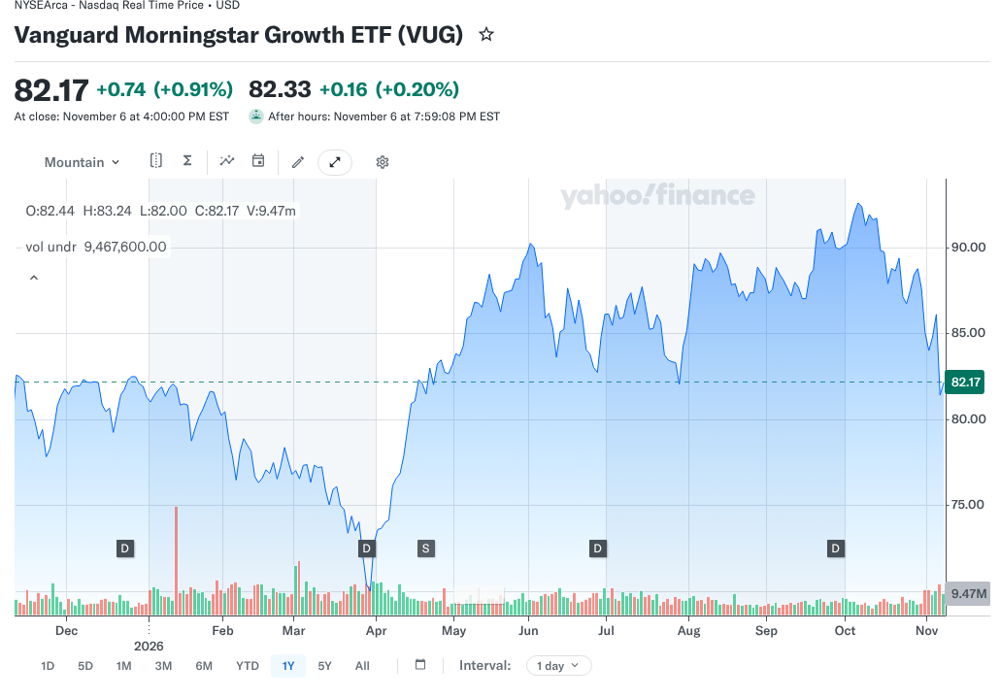
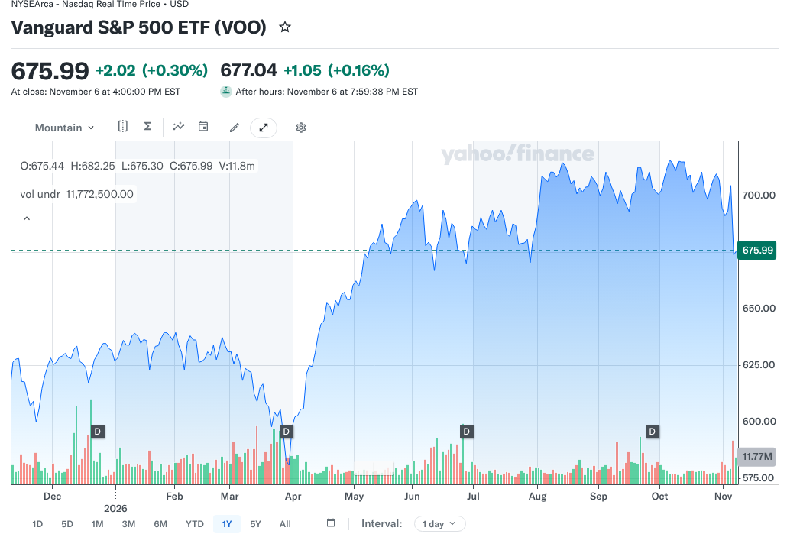

# VUG vs VOO in 2026: Growth Concentration or the Broad S&P 500?

Picking between VUG and VOO is not a choice between good companies and bad ones. Both funds own the largest U.S. businesses, and their top holdings are mostly the same names. The VUG vs VOO question is really about how much of your money rides on a small group of large growth companies.

VUG tracks large U.S. growth stocks. VOO tracks the whole S&P 500, which mixes growth companies with slower-growing, mature businesses. Both cost the same. The difference shows up in concentration: VUG owns far fewer stocks and puts much more weight in its biggest positions.

That makes this comparison a question about portfolio design more than fund quality. The sections below use Vanguard's own September 2026 data to show how large the concentration gap is, how much the two funds overlap and what happens to a portfolio that holds both. None of this is a recommendation to buy or sell either fund.

## Key Takeaways

- VUG held 135 stocks and VOO held 505 on September 30, 2026, according to Vanguard's fact sheets.
- The top 10 holdings made up 65.7% of VUG and 40.6% of VOO.
- Both funds list a 0.03% expense ratio as of April 28, 2026.
- Nvidia, Apple and Microsoft alone were 35.7% of VUG, compared with 21.6% of VOO, by our sum of fact-sheet weights.
- VOO is not a value fund, so pairing it with VUG increases a growth tilt rather than balancing one.

## VUG vs VOO at a Glance

The table uses Vanguard's fact sheets dated September 30, 2026. Holdings and weights change over time.

| Question | VUG | VOO |
|---|---|---|
| Full name | Vanguard Morningstar Growth ETF | Vanguard S&P 500 ETF |
| Benchmark | Morningstar US Large Cap Growth Index | S&P 500 Index |
| Focus | Large U.S. growth companies | Large U.S. companies across styles |
| Expense ratio | 0.03% (as of April 28, 2026) | 0.03% (as of April 28, 2026) |
| Number of stocks | 135 | 505 |
| Top 10 as share of assets | 65.7% | 40.6% |
| Fund launched | January 26, 2004 | September 7, 2010 |

The figures come from [Vanguard's VUG fact sheet](https://fund-docs.vanguard.com/F0967.pdf) and [VOO fact sheet](https://fund-docs.vanguard.com/F0968.pdf).

## What Does a Growth Fund Own?

Vanguard's fact sheet says VUG's index represents the growth companies of the Morningstar US Large Cap Index. Growth companies are those an index provider selects for traits linked to expansion, such as faster earnings or sales growth. The label describes the kind of company, not a promise that its stock will rise.

A strong business can still be a disappointing investment if its price already assumes years of excellent results. A slower-growing company can do well when expectations are low. Growth classification tells you what you own, not what you will earn.

### The Same Leaders, Different Weights

VUG and VOO share most of their top names. The difference is how much weight each fund gives them. The table compares the largest positions using each fact sheet.

| Company | Share of VUG | Share of VOO |
|---|---|---|
| Nvidia | 13.5% | 8.4% |
| Apple | 12.5% | 7.4% |
| Microsoft | 9.7% | 5.8% |
| Alphabet | 9.2% | 5.5% |
| Broadcom | 4.3% | 2.5% |
| Amazon | 4.3% | 3.7% |
| Meta Platforms | 4.2% | 2.4% |

Eli Lilly appears in VUG's top 10 at 2.6%, while Micron Technology appears in VOO's. The top four names alone make up 44.9% of VUG and 27.1% of VOO by our sum of the weights.

### Why 135 Stocks Can Be Concentrated

A fund with 135 stocks sounds diversified, but VUG weights them by market value. Its top 10 hold almost two-thirds of the fund, so the remaining 125 stocks share about a third. That means a few companies drive most of VUG's results, in good periods and bad ones.

## How the Two Indexes Are Built

The VUG vs VOO gap starts with each fund's index. VUG's fact sheet says its benchmark, the Morningstar US Large Cap Growth Index, represents the growth companies within the Morningstar US Large Cap Index and is designed for low turnover. VUG uses a full-replication strategy, meaning it aims to hold the index's stocks in their index weights.

The same fact sheet carries a notable warning. It says the fund may become nondiversified, as defined under the Investment Company Act of 1940, solely because of changes in market value or index weighting of one or more companies. In plain terms, a few holdings could grow large enough that the fund no longer meets the legal definition of diversified.

VOO tracks the S&P 500, which covers large U.S. companies across growth and value styles. Because it draws from a wider pool, the largest names carry less weight than they do in VUG, even though they still lead the fund.

## VOO Is Not a Value Fund

A common mistake is to treat VOO as the opposite of VUG. The S&P 500 includes growth companies and mature, slower-growing businesses, all weighted by market value. VOO is a blend of styles, not a value fund.

That changes how a two-fund mix behaves. Adding VUG to VOO does not create a balanced growth and value portfolio. It adds more weight to the same large growth companies that already lead VOO. An investor who wants value exposure would need to look at a fund built for that style.

## How Much Do VUG and VOO Overlap?

Heavily at the top. Every company in VUG's top 10 except Eli Lilly also appears in VOO's top 10. Because both funds weight by market value, those shared names carry a large part of each fund.

The useful question is not whether names overlap but how much of a combined portfolio ends up in the same companies. If you hold a large VOO position and add VUG, your total weight in Nvidia, Apple and Microsoft rises. Calculating combined weights from same-date fact sheets shows the real exposure before you add a growth tilt.

### A Hypothetical Combined Portfolio

Imagine $30,000 split evenly, $15,000 in each fund. Using the September 30 weights, Nvidia would be about $2,025 from VUG and $1,260 from VOO, or roughly 10.95% of the total. In VOO alone, Nvidia would be 8.4%. This is an illustrative calculation, and weights change daily.

### Overlap and the VTI Question

Overlap also shapes a related choice. A total-market fund holds every company in VOO plus thousands of smaller ones, while VUG narrows the field. FinLoom's comparison of [VTI vs VOO](/investing/vti-vs-voo/) shows how a broader fund changes concentration in the other direction, toward more holdings and less weight at the top.

## Is VUG Riskier Than VOO?

Neither fund has a fixed risk score, and both can lose value sharply. VUG's narrower mandate does make it more dependent on a small group of companies and on the expectations built into their prices. When those companies fall, VUG has fewer other holdings to cushion the drop.

Growth stocks often depend on hopes for future earnings. Changes in interest rates or forecasts can shift what investors will pay for those future profits, though the effect varies and other forces, such as business results and sentiment, also drive prices.

### Sector Concentration

Vanguard's fact sheet shows technology at 72.1% of VUG on September 30, 2026. VOO's fact sheet shows information technology at 39.7%. The two fact sheets use different sector classification systems, so the numbers are not a precise like-for-like comparison, but they show VUG leans far more heavily on technology.

### What VOO Still Carries

VOO's broader mix reduces the growth tilt, but it is still concentrated in large U.S. stocks and in a few giant companies. It is not a bond fund, a cash reserve or a substitute for a diversified portfolio that matches your time horizon.

## How to Size a Growth Tilt

Some investors choose VOO as a core and add a smaller VUG position on purpose. The size of that tilt changes the outcome more than the choice of fund alone. The examples below use September 30, 2026 weights and are illustrative calculations, not suggestions.

### An 80/20 Mix

With 80% in VOO and 20% in VUG, Nvidia's combined weight works out to about 9.4% (0.8 times 8.4%, plus 0.2 times 13.5%). That is about one point higher than VOO alone. The tilt is visible but modest, and the portfolio still behaves mostly like the S&P 500.

### A 50/50 Mix

With half in each fund, Nvidia's combined weight rises to about 10.95%, and Apple's to about 9.95%. The growth tilt is now much larger. Writing down the mix you want, then checking combined weights once or twice a year, keeps the tilt from drifting as growth stocks rise or fall.

## How to Check the VUG vs VOO Numbers Yourself

Fact sheets update every quarter, and weights move every day. A quick check keeps any comparison current.

### Compare the Top-10 Lines

Open both Vanguard fact sheets and read the ten largest holdings with their weights. Compare the top-10 totals. The gap between them is the clearest single measure of how much more concentrated VUG is. Note the as-of date on each sheet, since a quarter can shift weights by several points.

### Check the Sector Tables Carefully

Read each fund's sector table, but remember the two sheets may use different classification systems. A company can sit in technology on one list and communication or consumer categories on another. Use the sector tables to see the general lean, not to subtract one figure from another. If you need a precise sector comparison, look for two funds reported under the same system, or compare the individual top holdings, which are named the same way on both sheets.

## Do the Two ETFs Have Different Fees?

No. Vanguard lists a 0.03% expense ratio for both as of April 28, 2026. On a $50,000 balance that is about $15 a year at a constant balance, before market moves and trading costs. Because the fees match, cost does not separate VUG vs VOO.

Bid-ask spreads and broker fees still apply when you trade any ETF. Expense ratios can change, so check the current prospectus before investing. Because both funds trade on an exchange, a limit order can help you control the price you pay when markets are moving quickly, and checking the spread in your brokerage app before you buy takes only a moment.

## Dividends and Total Returns

Both funds pay dividends on a quarterly schedule, according to their fact sheets. Growth companies often reinvest more of their profits instead of paying them out, so a growth fund may yield less than a broad index fund. That is a general pattern, not a fixed rule, and yields change with prices.

A lower yield does not mean a lower total return, and a higher yield does not mean a better investment. Total return includes price changes and dividends together. FinLoom's guide to [dividend vs dividend yield](/investing/dividend-vs-dividend-yield/) explains how yield moves when prices change, which helps when comparing funds with different payout levels.

## Which Fund Fits Which Portfolio Role?

Start with the role. If you want a core holding that tracks the large-company U.S. market across styles, VOO is the direct fit. If you deliberately want more weight in large growth companies and accept higher concentration, VUG delivers that tilt.

Many investors who own VUG hold it beside a broader fund, as a deliberate tilt rather than a core. If you do that, decide the size of the tilt in advance and check the combined weights so the growth exposure does not grow larger than you intended.

Both are stock funds and can fall sharply. FinLoom's comparison of [crypto vs stocks](/investing/crypto-vs-stocks/) shows how drawdowns and volatility differ across asset types, which helps when setting how much of a portfolio belongs in stocks at all.

## Two Hypothetical Investors

These short profiles show how the VUG vs VOO choice can follow from a goal. They are illustrations, not recommendations.

### Investor A Wants One Core Fund

Investor A wants a single fund that tracks large U.S. companies and does not want to manage a tilt. VOO matches that aim because it covers the S&P 500 across styles. Investor A accepts that VOO still leans on a few giant companies but prefers not to add more weight to them.

### Investor B Wants a Deliberate Growth Tilt

Investor B already holds a broad core fund and wants extra weight in large growth companies, knowing it raises concentration. VUG delivers that tilt. Investor B decides on a fixed share for VUG in advance and checks the combined holdings once a year so the tilt stays at the intended size.

## Common Mistakes When Comparing VUG and VOO

The first mistake is choosing based on a recent chart. A growth fund that led for a year can lag the next, and the reverse is just as common. The second is assuming more funds mean more diversification. VUG and VOO share their biggest holdings, so holding both mainly concentrates the same names.

The third is treating VOO as a value counterweight. It is a blend fund that already leans heavily on the same large growth companies. The fourth is ignoring the as-of date. Weights shift every quarter, so confirm the current fact sheets before you rely on any number, including the ones here.

## Frequently Asked Questions

### Is VUG Better Than VOO?

Neither is better for everyone. VUG concentrates in large growth companies, while VOO tracks the broader S&P 500. Both cost 0.03%, and neither promises higher future returns.

### Is VUG Riskier Than VOO?

VUG is more concentrated, with 65.7% in its top 10 against VOO's 40.6%. That makes it more dependent on a few companies, though both can fall sharply.

### Can I Hold VUG and VOO Together?

Yes, but the overlap is large. Holding both raises your weight in the same big growth companies rather than adding a different kind of investment or a value tilt.

### Do VUG and VOO Pay Dividends?

Yes. Both fact sheets list a quarterly dividend schedule. Growth funds often yield less, so compare total returns with dividends reinvested instead of yield alone.

### What Is the Main Difference in VUG vs VOO?

VUG holds 135 large growth stocks with heavy weight at the top. VOO holds the 505-stock S&P 500 across styles. Fees are the same.

## Resources

- [Vanguard: VUG fact sheet, September 30, 2026](https://fund-docs.vanguard.com/F0967.pdf)
- [Vanguard: VOO fact sheet, September 30, 2026](https://fund-docs.vanguard.com/F0968.pdf)
- [Vanguard: VOO fund profile](https://advisors.vanguard.com/investments/products/voo/vanguard-sp-500-etf)
- [Yahoo Finance: VUG chart](https://finance.yahoo.com/quote/VUG/chart/)
- [Yahoo Finance: VOO chart](https://finance.yahoo.com/quote/VOO/chart/)

*Investing involves risk, including possible loss of principal. This comparison is educational and is not investment advice. Fund data and costs can change, so confirm them with Vanguard before investing.*
