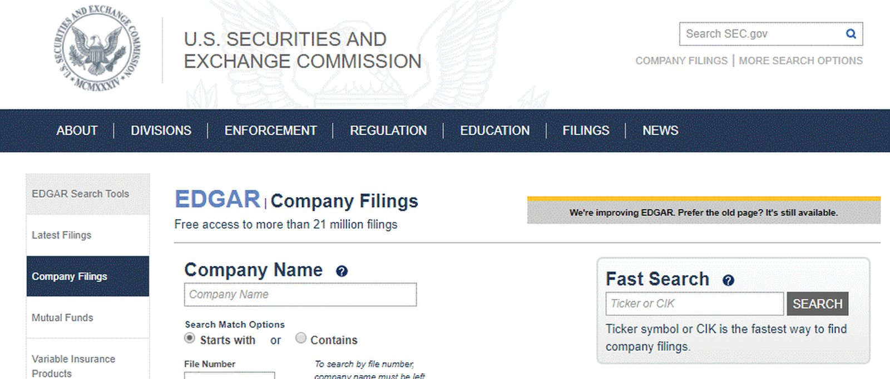
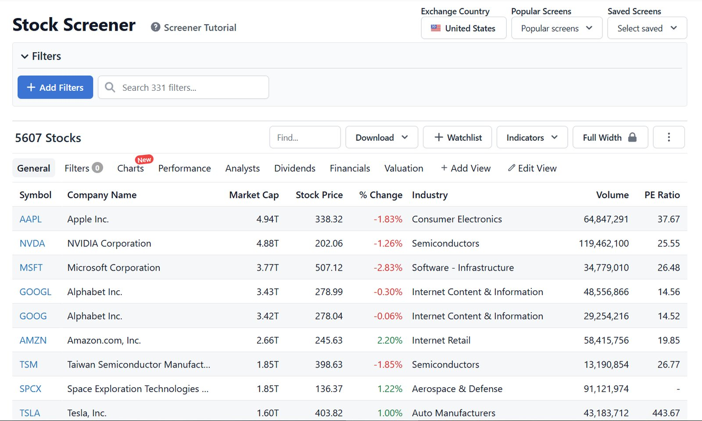
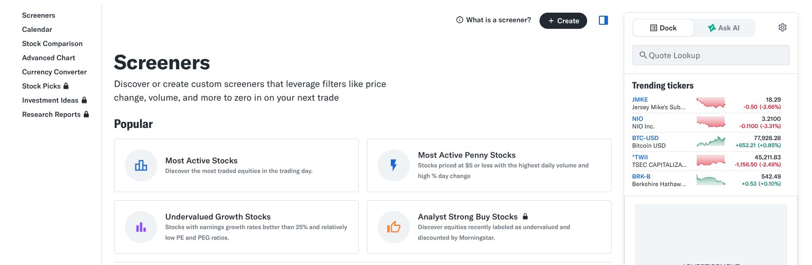
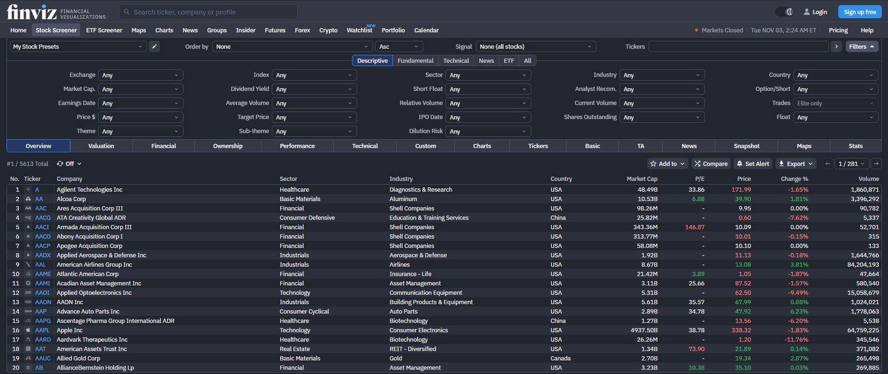
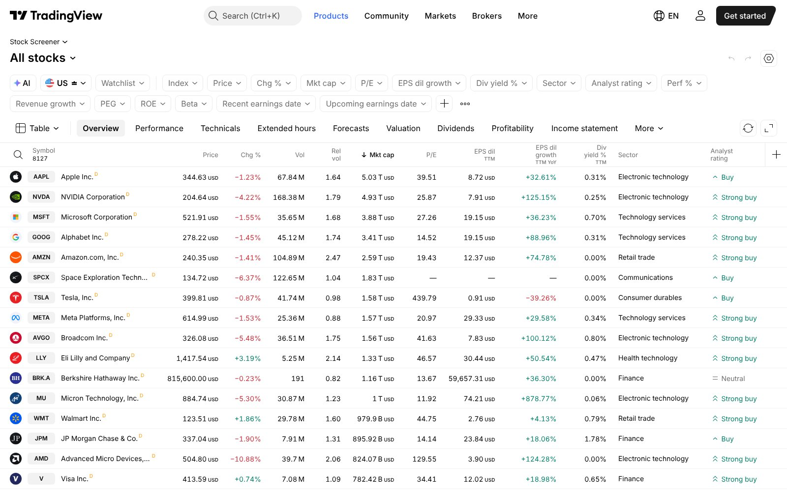
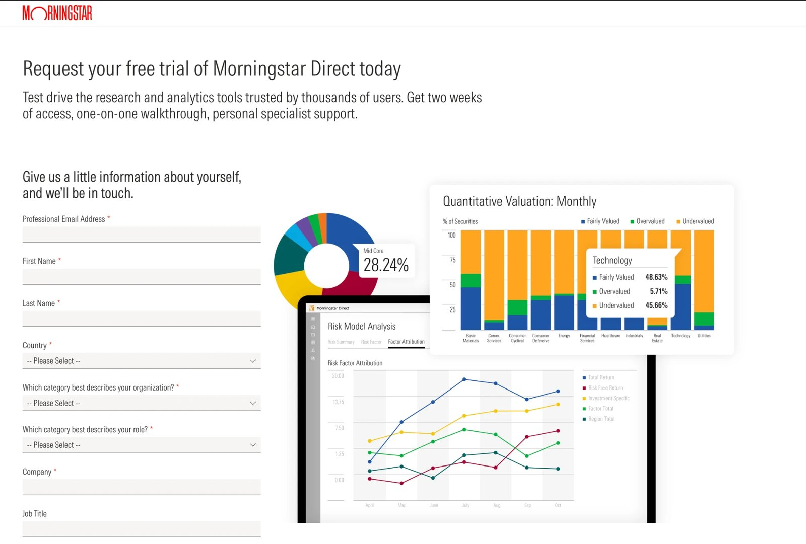
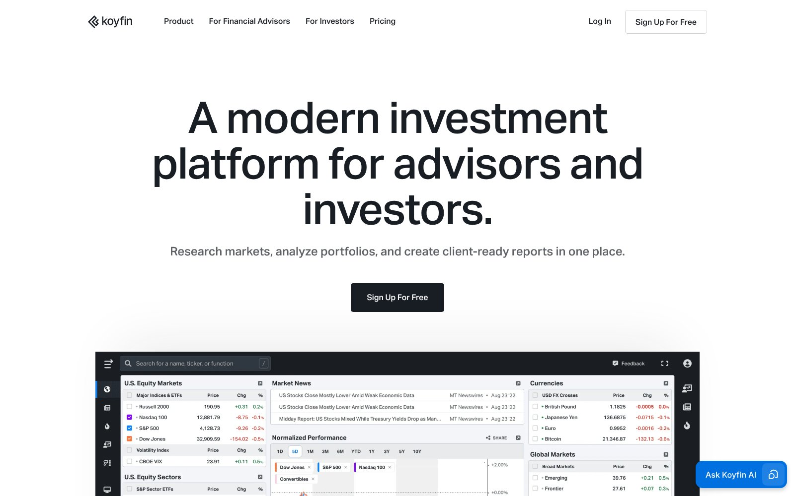

# Best Stock Analysis Websites for Fundamental Research: Free and Paid Options

The best stock analysis websites do different jobs. One holds the official filings. Another turns those filings into readable tables. Others screen thousands of stocks, chart prices or build dashboards. No single site does everything well, so a good research process uses a few of them in order.

This guide covers seven websites by role rather than by a single ranking. Each section says what the site is for and where it fits in a research workflow, and shows a real screenshot of the product. It is a capability-based comparison, not a hands-on test of every paid plan, and it does not list current subscription prices. Sources and screenshots were reviewed in November 2026.

## Key Takeaways

- **Start with the source:** SEC EDGAR holds U.S. companies' official filings and offers free access to more than 21 million of them, according to its search page.
- **Use readable summaries for speed:** Stock Analysis says it covers 150,000+ global stocks and funds with prices, financials, forecasts and charts.
- **Screen before you research:** Finviz, TradingView and Yahoo Finance offer screeners that narrow a large market to a short list.
- **Use charts for context:** TradingView is built around interactive charts, indicators and alerts, with a free Basic plan.
- **Dashboards suit deeper work:** Koyfin combines statements, estimates, charts, macro data and dashboards in one workspace.
- **Professional tools cost more:** Morningstar Direct offers a two-week free trial with a walkthrough, aimed at professional users.

## What Makes a Stock Research Website Useful?

Among the best stock analysis websites, a useful site answers a specific question well. Some questions need the original source, such as what a company reported in its annual filing. Others need speed, such as how a company's margins compare with peers. Others need filtering, such as which companies meet a set of criteria. Matching the site to the question saves time.

Traceability is the second test. A number on a summary site should be checkable against the company's filing. Sites that show the fiscal period, the source and the date of each figure make that check easier. The best stock analysis websites for serious research make it simple to move from a summary back to the source.

### The Three Layers of Research

It helps to think in three layers. The first is source data, meaning the filings a company submits to regulators. The second is processed data, where a site organizes filings into tables, ratios and charts. The third is discovery, where screeners and dashboards help find companies worth a closer look.

Each layer has strengths and limits. Source data is authoritative but slow to read. Processed data is fast but can contain errors or different definitions. Discovery tools are useful for narrowing a list, but they say little about whether a business is sound. The [stock analysis fundamentals](/markets-stocks/stock-analysis-fundamentals/) guide explains which numbers count most once you reach the source layer.

### Free vs Paid Access

Many of the best stock analysis websites offer a free tier and paid upgrades. Free tiers often cover quotes, basic financials and simple screens. Paid tiers can add longer histories, more filters, real-time data, exports and alerts. The right level depends on how often you research and how deep you go.

Prices and plan features change often, and this guide does not list them. Checking each provider's current plan page before subscribing is the reliable way to compare costs. A free trial, where offered, lets you test whether a paid feature changes your process before paying for it.

## 1. SEC EDGAR: The Source of Record

[SEC EDGAR](https://www.sec.gov/edgar/searchedgar/companysearch) is the U.S. Securities and Exchange Commission's filing system. Its company search page describes free access to more than 21 million filings. Annual reports, quarterly reports, current reports and many other disclosures land here first, before any summary site processes them.

The interface is plain, but it is the strongest place to verify what a company filed. The search page offers a company name search with "starts with" and "contains" options, plus a Fast Search by ticker symbol or CIK, which the page calls the fastest way to find company filings.

### When to Use EDGAR

Use EDGAR when a number will drive your decision. If a summary site shows revenue, debt or share count, the filing is the place to confirm it. Filings also contain context that summaries leave out, such as risk factors, segment details and management's discussion of results.

EDGAR is also the place to check timing. A filing's date shows when information became public. That helps when comparing a company's results with its share price movements or when checking whether a figure on another site is current or out of date.

### Limits of EDGAR

EDGAR is not built for quick comparisons. Reading several annual reports to compare margins across companies takes time. The site does not rank companies, screen them or chart their prices. Most researchers use it alongside a faster summary site rather than on its own.

The volume of filings is also a challenge for new users. Knowing which form types hold which information, such as annual versus quarterly reports, makes searches faster. Starting from a company's filing list and filtering by form type is a practical way in.

## 2. Stock Analysis: Readable Fundamentals

[Stock Analysis](https://stockanalysis.com/) describes itself as an all-in-one stock analysis platform with information on 150,000+ global stocks and funds. Its homepage lists stock prices, news, financials, forecasts and charts. It organizes company data into tables that are quick to scan.

That format suits someone looking at several companies' statements side by side. The site also has a stock screener, shown above, and mobile apps for iOS and Android. Its homepage advertises paid Pro and Unlimited plans alongside free access.

### Best Fit

Stock Analysis works well as a second step after finding a company. It turns filings into income statement, balance sheet and cash flow tables that are easier to read than raw documents. That makes it useful for quick trend checks over several years.

Like any summary site, it is worth checking key figures against EDGAR. Definitions for items such as adjusted earnings or free cash flow can differ from site to site, and fiscal periods may not line up across companies. A quick filing check confirms what a number represents.

### What to Watch For

Summary tables compress detail. A single revenue figure can hide changes in segments or one-time items. When a trend looks unusual, the filing's notes usually explain why. Treating the summary as a map, and the filing as the territory, keeps analysis grounded.

Plan limits are another point to check. Some data, such as longer histories or exports, may sit behind a paid tier. Testing the free version against your own research needs shows whether an upgrade adds value.

## 3. Yahoo Finance: Market Context

Yahoo Finance combines quotes, company profiles, news and selected financial data. For many people, it is the easiest place to follow a company's share price and headlines. Its screener page offers preset screens such as Most Active Stocks and Undervalued Growth Stocks.

Its screener states that it covers 50 regions. The [Yahoo Finance stock research](/markets-stocks/yahoo-finance-stock-research/) guide covers what the free and paid plans include and how to use the site for a first look at a company.

### Best Fit

Yahoo Finance suits monitoring and first impressions. Watchlists, quotes and news in one place make it easy to keep track of a handful of companies. It is a common starting point before moving to a filing or a deeper data site.

It is less suited to detailed fundamental comparisons. For a close look at multi-year financial statements or segment data, a dedicated fundamentals site or the filing itself provides more detail. Using Yahoo Finance for context and other sites for depth plays to each one's strengths.

### What to Watch For

News feeds move fast, and headlines can shape impressions more than numbers do. Separating what a company reported from how the news described it helps. Checking the original filing or earnings release for any figure quoted in a headline is a good habit.

Data definitions also vary. A valuation ratio shown on one site can differ from another because of different earnings measures or dates. Comparing like with like, using the same source for every company on a list, keeps comparisons fair.

## 4. Finviz: Screening Before Deeper Research

Finviz is widely used for stock screening and market visualization. Its screener lets users filter U.S. stocks by descriptive, fundamental and technical criteria, then view the results in a table. That helps shrink a large market to a short list.

The free version supports broad screening. The paid Finviz Elite tier adds real-time market data, more advanced filters, saved presets, alerts, exports, longer financial statement history and expanded charting. The [best free stock screeners](/markets-stocks/best-free-stock-screeners/) guide compares Finviz with other free screening options.

### Best Fit

Screeners like Finviz are for finding candidates, not judging them. A screen for a sector, size range and profitability level can turn thousands of stocks into a few dozen. Each name on that list then needs proper research in the filings and statements.

Screens also help test ideas. Changing one filter at a time shows how sensitive a list is to each criterion. A list that changes dramatically with a small tweak may be built on thin assumptions, which is worth knowing before going deeper.

### What to Watch For

Screens use the data provider's definitions and update schedule. A stock can pass a screen because of a one-time gain or an outdated figure. Confirming the key numbers in the filing before drawing conclusions avoids being misled by a stale or unusual data point.

Screening is the start of research, not the end of it. Treating a screener result as a buy list skips the most important work. FinLoom does not recommend buying, selling or holding any stock, and a screen is only a way to decide what to study.

## 5. TradingView: Charts and Price Context

TradingView is built around interactive charts, indicators, screeners, alerts and multi-market monitoring. It is commonly used for technical analysis, which studies price and volume patterns. Its free Basic plan covers entry-level use.

TradingView's screener, shown above, lists stocks with columns such as price, change, P/E ratio, dividend yield, sector and analyst rating. Charts let users view price history alongside volume and other studies.

### Best Fit

For fundamental research, TradingView adds price context. A company's results can be lined up against how its share price moved before and after each report. That helps separate business performance from market sentiment.

TradingView also suits investors who combine fundamental and technical views. Someone who studies a company's statements may still want to see how the stock has traded. Having charts and a screener in one place makes that combination easier.

### What to Watch For

Charts show what happened to a price, not why. Patterns that seem clear in hindsight are harder to use in real time. Using charts as context for fundamental work, rather than as a standalone signal, keeps them in proportion.

Community content on charting platforms comes from many users with different skill levels. Posts and ideas shared by other users are opinions, not research. Weighing them as such, and checking claims against filings and data, avoids taking an unsupported view on trust.

## 6. Morningstar Direct: Professional Research

Morningstar offers company and fund research, and Morningstar Direct is its professional research and analytics platform. The free trial page invites users to test drive the research and analytics tools and offers two weeks of access, a one-on-one walkthrough and personal specialist support.

The trial page shows sample views such as a quantitative valuation chart by sector and a risk model analysis. The sign-up form asks for a professional email address, organization category and role, which signals that Morningstar Direct is aimed at professional users rather than casual investors.

### Best Fit

Morningstar Direct suits analysts, advisors and institutions that need structured fund and company research in one platform. Its sample screens show portfolio-level analysis, such as valuation spread across sectors and risk factor attribution, which goes beyond what most free sites offer.

For individual investors, Morningstar's broader website and other free tools may cover more everyday needs. Readers comparing Morningstar's screening tools for individual use can find more detail in FinLoom's Morningstar stock screener review, which covers features outside the Direct platform.

### What to Watch For

Professional platforms come with professional pricing, which is usually set through a sales process rather than a public price list. The two-week trial is the best way to judge whether the depth justifies the cost. Planning what to test during the trial makes those two weeks more useful.

Proprietary ratings and valuations are also worth reading critically. A fair value estimate or rating reflects a model and its assumptions. Understanding the method behind a rating, rather than treating it as a verdict, keeps the analysis your own.

## 7. Koyfin: Comparative Dashboards

[Koyfin](https://www.koyfin.com/) describes itself as a modern investment platform for advisors and investors. Its homepage says users can research markets, analyze portfolios and create client-ready reports in one place, with access to live market data.

Koyfin combines equities, financial statements, estimates, charts, macro data, dashboards, filings, transcripts and portfolio tools in one workspace. That breadth suits someone who wants to compare several companies or metrics on one screen.

### Best Fit

Koyfin works well for comparative research. Dashboards can put several companies' valuation, growth and margin figures side by side, along with charts. That makes it easier to see how a company stacks up against peers without switching between many pages.

It also suits investors who track macro data alongside company data. Seeing interest rates or economic indicators next to company results can help explain trends that a single company's statements do not.

### What to Watch For

Powerful dashboards can encourage collecting more data than you use. Deciding in advance which metrics answer your research question keeps dashboards focused. A few well-chosen measures are more useful than dozens of loosely related ones.

As with every summary platform, key figures are worth checking against filings. Estimates and adjusted measures, in particular, depend on definitions that vary by provider. Knowing where each number comes from keeps comparisons consistent.

## A Practical Research Workflow

The best stock analysis websites work best in sequence. Start with a screener, such as Finviz, TradingView or Yahoo Finance, to build a short list. Move to a summary site, such as Stock Analysis or Koyfin, to compare statements and ratios. Then confirm the numbers that drive your view in the company's EDGAR filings.

Whichever of the best stock analysis websites you use, a simple worksheet keeps the process consistent. For each company, record revenue growth, operating margin, free cash flow, shares outstanding, debt and a valuation measure, along with the fiscal period and source for each figure. Comparing the same items for every company avoids mixing periods or definitions.

| Research Step | Example Websites | What You Get |
|---|---|---|
| Find candidates | Finviz, TradingView, Yahoo Finance | A short list from screening |
| Compare fundamentals | Stock Analysis, Koyfin | Multi-year statements and ratios |
| Add price context | TradingView, Yahoo Finance | Charts and market reaction |
| Verify the numbers | SEC EDGAR | Official filed disclosures |
| Professional depth | Morningstar Direct | Structured research and analytics |

Among the best stock analysis websites, each step in the table hands off to the next.

### Why Verification Comes Last

Verification sits at the end because it is slow and precise. Screening and summaries narrow the list so that only the most promising companies get a full filing review. Reading every filing for every company would take far too long to be practical.

Verification still cannot be skipped. A decision built on a wrong number is worse than no decision. Confirming the handful of figures that drive your conclusion, such as revenue trend, margins and debt, is the step that turns a quick look into real research.

### Keeping a Research Log

A dated log of what you checked, where and when adds discipline. It shows which figures came from filings and which came from summary sites. It also makes it easy to update your view when a new quarterly report arrives, since you know exactly which numbers to refresh.

Logs help with honesty too. Writing down why a company looked interesting, before seeing how its stock performs, makes it harder to rewrite the reasoning later. Over time, a log shows which research habits led to good decisions.

## The Bottom Line

The best stock analysis websites cover different steps. SEC EDGAR is the source of record. Stock Analysis and Koyfin make statements easier to compare. Finviz, TradingView and Yahoo Finance help screen and add market context. Morningstar Direct serves professional users. Use them in sequence, verify key numbers in filings, and check each provider's current plans before paying.

## Frequently Asked Questions

### Can I Research U.S. Stocks for Free?

Yes. SEC EDGAR offers free access to company filings, and many sites, including Stock Analysis, Finviz, TradingView and Yahoo Finance, have free tiers with quotes, financials and screeners.

### Is Stock Screening the Same as Stock Analysis?

No. Screening filters a market down to a list of candidates. Analysis studies each company's filings, statements and business to judge it. Screening comes first and analysis follows.

### Why Check Numbers in SEC Filings?

Summary sites process filings and can differ in definitions, periods or accuracy. The filing is the official disclosure, so it is the most reliable source for key figures.

### Which Site Is Best for Beginners?

Yahoo Finance is an easy starting point for quotes, news and watchlists. Pairing it with a readable fundamentals site and occasional EDGAR checks builds good research habits.

### Are Paid Stock Research Sites Worth It?

It depends on how often and how deeply you research. Free trials and free tiers let you test whether paid features, such as longer histories or exports, change your process.

## Resources

- [SEC EDGAR Company Search](https://www.sec.gov/edgar/searchedgar/companysearch)
- [Stock Analysis](https://stockanalysis.com/)
- [Finviz Elite](https://finviz.com/elite)
- [Koyfin](https://www.koyfin.com/)

*This article compares research websites for general education. It is not investment or personalized financial advice, and it is not a recommendation to buy, sell or hold any security.*
