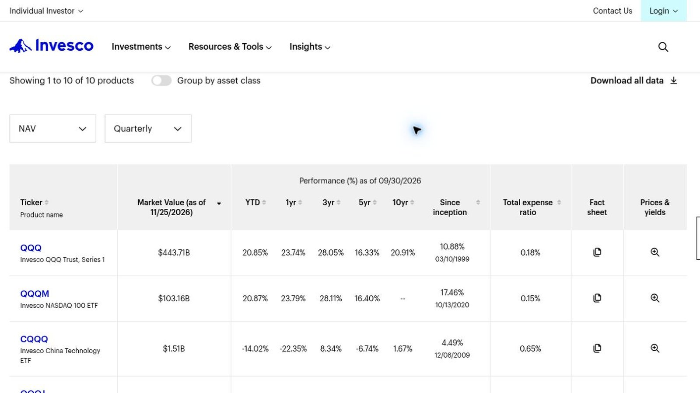

# QQQ vs QQQM: Fees, Trading and the Cost of Holding Nasdaq-100 ETFs

QQQ and QQQM both come from Invesco and both give investors exposure to the Nasdaq-100. The difference in a QQQ vs QQQM comparison is mostly cost and use. Invesco's ETF directory lists a 0.18% total expense ratio for QQQ and 0.15% for QQQM. That three-basis-point gap is small for a short holding period and adds up slowly for someone who holds for years.

A lower fee does not settle the question on its own. Trading costs, how often you buy and sell, taxes on an existing position and the size of each fund can all count for more. This guide uses Invesco's published data, labels every example and does not rank past returns. Data was reviewed on November 26, 2026.

## Key Takeaways

- **Same index, same issuer:** both funds track the Nasdaq-100 and are managed by Invesco.
- **Fees differ by 0.03 percentage points:** Invesco lists QQQ at 0.18% and QQQM at 0.15%.
- **QQQ is far older and larger:** QQQ launched March 10, 1999, and had $443.71 billion in market value on November 25, 2026, against $103.16 billion for QQQM, launched October 13, 2020.
- **The fee gap is $3 a year per $10,000:** that assumes a constant balance, before trading costs and taxes.
- **Switching can cost more than it saves:** selling QQQ at a gain in a taxable account can create a tax bill larger than years of fee savings.
- **Neither fund is diversified across the whole market:** the Nasdaq-100 is a concentrated large-company index.

## QQQ vs QQQM at a Glance

The table below comes from the [Invesco ETF directory](https://www.invesco.com/us/en/financial-products/etfs.html), which lists both funds in the same table. Market values are as of November 25, 2026. The directory showed performance as of September 30, 2026, which this guide does not use.

| Feature | QQQ | QQQM |
|---|---|---|
| Full name | Invesco QQQ Trust, Series 1 | Invesco NASDAQ 100 ETF |
| Benchmark | Nasdaq-100 | Nasdaq-100 |
| Total expense ratio | 0.18% | 0.15% |
| Inception date | March 10, 1999 | October 13, 2020 |
| Market value (Nov 25, 2026) | $443.71 billion | $103.16 billion |

### Reading the Table

The benchmark row is identical, which is the core of the QQQ vs QQQM comparison, as each fund's own page confirms: the [QQQ fund page](https://www.invesco.com/us/en/financial-products/etfs/invesco-qqq-trust-series-1.html) and the [QQQM fund page](https://www.invesco.com/us/en/financial-products/etfs/invesco-nasdaq-100-etf.html). Both funds aim to hold the same companies in roughly the same weights. Over most periods, their returns before fees should be very close. Small gaps can still appear because of cash, timing and how each fund manages its portfolio.

The rows that differ are cost, age and size. QQQ is the original fund and is more than four times larger by market value. QQQM is the newer, lower-cost version. For many readers, the choice comes down to which of those features fits how they plan to use the fund.

### What the Nasdaq-100 Is

The Nasdaq-100 holds large companies listed on the Nasdaq stock market and excludes financial companies. It is weighted by market value, so the biggest companies take the largest shares. That makes it more concentrated than a broad index such as the S&P 500 or a total-market fund.

Because large technology and growth companies make up much of the index, both funds can rise and fall sharply with that part of the market. Choosing between QQQ and QQQM does not change that exposure. It only changes how much you pay to hold it and how easily you can trade it.

## How Much Does the Fee Gap Cost?

The expense ratio is the yearly fund operating cost as a share of assets. The gap between 0.18% and 0.15% is 0.03 percentage points. On a $10,000 balance that stays the same all year, that works out to $10,000 × 0.0003 = $3. These are illustrations of the fee rate, not real charges.

| Constant Balance | QQQ at 0.18% | QQQM at 0.15% | Yearly Difference |
|---|---|---|---|
| $10,000 | $18 | $15 | $3 |
| $50,000 | $90 | $75 | $15 |
| $100,000 | $180 | $150 | $30 |
| $250,000 | $450 | $375 | $75 |

In every row of this QQQ vs QQQM fee table, the gap is the balance multiplied by 0.0003. Doubling the balance doubles the dollar difference.

### Why the Numbers Are Approximate

Fund expenses are not billed to you directly. They come out of the fund's assets bit by bit, which slightly lowers its return. Balances also rise and fall with the market, so the dollar cost in any real year will differ from the table. The table shows the scale of the gap, not a forecast.

The gap repeats every year and compounds, because fees reduce the balance that later grows. Over decades, a small yearly difference can add up. Measuring that precisely needs assumptions about returns, contributions and future fees. The [expense ratio calculator](/investing/expense-ratio-calculator/) lets you test those assumptions with your own balance and time frame.

### Fee Gap Over a Holding Period

Another way to read the gap is per year held. Someone who holds $50,000 for ten years at a steady balance would see roughly $150 of difference in fees, at $15 a year. With growth or regular contributions, the balance and the gap would both be larger. With losses, both would be smaller.

That rough math helps put the gap next to other costs. A single trade with a wide spread, a commission or a tax bill can be larger than several years of the fee difference. Seeing the numbers side by side keeps any one cost from deciding the question alone.

### Fees Can Change

Expense ratios are set by the fund and can change. The figures in this guide are those Invesco listed when the page was reviewed. Checking each fund's current prospectus or fact sheet before investing is the reliable way to confirm the fee you would pay.

A fee comparison is also only one part of a decision. Two funds tracking the same index with nearly identical fees will usually deliver returns that differ by roughly the fee gap. Anything larger tends to come from timing, cash or trading, which are covered next.

## When Can Trading Costs Outweigh the Fee Gap?

ETFs trade like stocks, so buyers and sellers pay a bid-ask spread, the difference between the price buyers offer and the price sellers accept. Spreads vary with market conditions, trade size and the time of day. They are not a fixed yearly percentage like an expense ratio.

For someone who buys once and holds for years, the spread is a one-time cost on each purchase and sale. For an active trader who buys and sells often, spreads can add up faster than the yearly fee gap. That is the main reason some traders prefer a larger, more heavily traded fund even when its fee is higher.

### A Labeled Trading Example

Here is a purely hypothetical QQQ vs QQQM case. Suppose an investor makes a $20,000 trade, and the all-in execution cost on one fund is 0.02 percentage points higher than on the other. That is $4 on that single trade. The yearly fee gap on a $20,000 balance is $6. One extra round trip a year can wipe out most of the fee advantage.

These numbers are illustrations, not measured spreads. They do not show which fund trades more cheaply in practice. A real comparison needs quotes for both funds captured at the same time and trade size, or the issuer's published spread statistics for the same period.

### Order Types and Commissions

A limit order sets the highest price you will pay or the lowest you will accept. It can help avoid a poor fill when spreads widen, though the order may not execute. Market orders fill immediately at the best available price, which can be unfavorable in fast markets.

Some brokerages charge commissions on ETF trades, and others do not. Fractional share support also varies. These broker features can affect the real cost of buying either fund, especially for smaller or more frequent purchases.

## Should a Long-Term Investor Pick QQQM?

On the published fee alone, QQQM costs less to hold, which is the simplest part of the QQQ vs QQQM decision. For a new long-term position bought once and held, that lower fee is a clear and known difference. FinLoom does not recommend buying, selling or holding either fund. The point is to show which facts drive the comparison.

Three questions come before the fee. Do you want concentrated Nasdaq-100 exposure at all? How long do you expect to hold it? How often will you trade? Someone who already owns a broad market fund may find that either Nasdaq fund adds a large tilt toward a narrow group of companies.

### The Tax Cost of Switching

For someone who already owns QQQ in a taxable account, switching to QQQM is not free. Selling QQQ at a gain creates a capital gains tax bill. That tax can easily exceed many years of fee savings. A $30 yearly saving on $100,000 takes a long time to offset even a modest tax bill on a large gain.

Selling at a loss and buying the other fund raises a different question under the wash sale rule, because the two funds track the same index. The IRS treats whether two securities are substantially identical as a facts-and-circumstances question. Anyone trading around a loss should review that rule and consider professional advice.

### Retirement Accounts Are Different

Inside an IRA or 401(k), selling one fund to buy another generally does not trigger a capital gains tax bill at the time of the trade. That removes the main obstacle to switching. The decision then comes down mostly to fees, trading costs and whether the plan or brokerage offers both funds.

Even then, a switch has small costs. Spreads apply to both the sale and the purchase, and the money may be out of the market briefly between trades. For a long holding period, those one-time costs are usually small next to the yearly fee gap, but they are not zero.

## How QQQ and QQQM Fit a Portfolio

Both funds hold the same narrow slice of the market. Owning both does not add diversification, because they track the same index. It can make sense only for practical reasons, such as holding QQQ in an older account and buying QQQM with new money in another.

Dividend-focused funds take a very different approach, selecting stocks for their payouts rather than their size on one exchange. The [SCHD vs VYM](/investing/schd-vs-vym/) comparison shows how two dividend ETFs differ in method and cost, which is useful context for investors weighing growth-heavy and income-focused funds.

### Buying in Small Amounts

Investors who add money every month face a slightly different QQQ vs QQQM question. Each purchase pays a spread, so frequent small buys add many small trading costs. Fractional share support at the brokerage also shapes the choice, because a fund with a lower share price can be easier to buy in whole shares with small amounts.

The fee gap still applies to every dollar invested, and it grows as the balance grows. For a regular saver planning to hold for a long time, the yearly fee usually counts for more than the spread on each small purchase. Checking the brokerage's fractional and recurring purchase options helps settle the practical side.

### Concentration Risk

A fund tracking the Nasdaq-100 can hold a large share of its value in a handful of companies. When those companies fall together, the fund can drop faster than a broader index. Neither QQQ nor QQQM reduces that risk. Diversification comes from what else a portfolio holds.

The [crypto vs stocks](/investing/crypto-vs-stocks/) guide covers broader questions about risk and volatility across asset classes. Those choices shape a portfolio's behavior far more than picking between two funds that track the same index.

## Questions to Ask Before Choosing

Before deciding, it helps to write down a few answers. What role will the fund play in the portfolio, a core holding or a smaller tilt? Which account will hold it, taxable or tax-advantaged? Does the brokerage offer both funds commission-free, with fractional shares and automatic investing? How often will you add money or rebalance?

The answers often point clearly to one fund. A long-term saver in a retirement account adding money monthly may lean toward the lower fee. A frequent trader may weigh spreads and trading volume more heavily. An investor sitting on a large taxable gain in QQQ may find that keeping the position costs less than switching. In each case, the QQQ vs QQQM decision follows from how the fund will be used.

## A Repeatable QQQ vs QQQM Checklist

A short checklist keeps the comparison grounded. Record both funds' current expense ratios and the date shown on the issuer's page. Check recent spreads for both on the same day and at your usual trade size. Confirm the benchmark is still the same for both. Estimate how often you plan to trade.

If you already own one fund, add the tax cost of selling it and any transfer or trading costs. For a taxable account, compare that cost with the yearly fee saving to see how many years it would take to break even. That simple comparison often answers the question on its own.

## The Bottom Line

QQQ and QQQM track the same Nasdaq-100 index from the same issuer. Invesco lists QQQM at 0.15% and QQQ at 0.18%, a gap of $3 a year per $10,000 on a constant balance. QQQ is older and much larger by market value. For a new long-term holding, the lower fee is the clearest difference. For traders and existing taxable holders, spreads and taxes can outweigh the fee gap.

## Frequently Asked Questions

### Do QQQ and QQQM Hold the Same Stocks?

Both track the Nasdaq-100, so their holdings are nearly the same. Small differences can appear in cash or reporting dates, because each fund manages its own portfolio.

### Is a 0.03% Fee Difference Worth Switching For?

It depends on balance, holding period, trading costs and taxes. On a constant $10,000, the gap is $3 a year, which a tax bill on a gain can easily exceed.

### Which Is Bigger, QQQ or QQQM?

QQQ. Invesco's directory showed QQQ at $443.71 billion and QQQM at $103.16 billion in market value as of November 25, 2026. QQQ launched in 1999.

### Does QQQM Guarantee Higher Returns?

No. A lower fee removes one small drag on returns, but both funds can fall in value. Neither fund guarantees a return or protects against market declines.

### Can I Hold Both QQQ and QQQM?

You can, but it adds no diversification because both track the same index. Some investors hold both for practical reasons, such as using different accounts.

## Resources

- [Invesco ETF Directory](https://www.invesco.com/us/en/financial-products/etfs.html)
- [Invesco QQQ Trust, Series 1 (QQQ)](https://www.invesco.com/us/en/financial-products/etfs/invesco-qqq-trust-series-1.html)
- [Invesco NASDAQ 100 ETF (QQQM)](https://www.invesco.com/us/en/financial-products/etfs/invesco-nasdaq-100-etf.html)

*This article compares funds for general education. It is not investment, tax or personalized financial advice, and it is not a recommendation to buy, sell or hold any security.*
