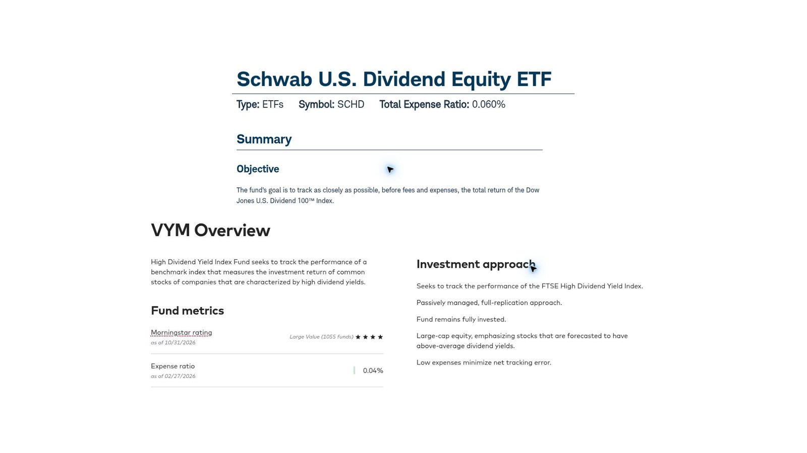

# SCHD vs VYM: Dividend Screening, Yield and What the Fees Mean

SCHD and VYM are both U.S. dividend stock ETFs, but they build their portfolios in different ways. SCHD tracks the Dow Jones U.S. Dividend 100 Index. VYM tracks the FTSE High Dividend Yield Index. That difference in method, more than the small gap in fees, is the heart of any SCHD vs VYM comparison.

Schwab lists a 0.060% total expense ratio for SCHD. Vanguard lists 0.04% for VYM, as of February 27, 2026. This guide explains what each index aims to hold, why a higher yield is not the same as a better fund, and how to compare the two fairly. It uses issuer data and labeled examples, and it does not rank past returns. Data was reviewed on November 26, 2026.

## Key Takeaways

- **Different indexes:** SCHD tracks the Dow Jones U.S. Dividend 100 Index, and VYM tracks the FTSE High Dividend Yield Index.
- **Small fee gap:** Schwab lists SCHD at 0.060%, and Vanguard lists VYM at 0.04%, a difference of $2 a year per $10,000 on a constant balance.
- **VYM uses full replication:** Vanguard describes VYM as passively managed with a full-replication approach in large-cap stocks forecast to have above-average dividend yields.
- **Yield is not total return:** a falling share price can push a yield up without making a fund safer.
- **Overlap needs same-date data:** comparing holdings fairly requires both funds' holdings files from the same date, weighted by position size.
- **Dividends can be cut:** neither fund promises a set level of income.

## SCHD vs VYM at a Glance

The table below summarizes what each issuer publishes about its fund's goal and cost. SCHD figures come from the [Schwab SCHD fund page](https://www.schwabassetmanagement.com/products/schd). VYM figures come from the [Vanguard VYM fund page](https://advisors.vanguard.com/investments/products/vym/vanguard-high-dividend-yield-etf).

| Feature | SCHD | VYM |
|---|---|---|
| Full name | Schwab U.S. Dividend Equity ETF | Vanguard High Dividend Yield ETF |
| Index tracked | Dow Jones U.S. Dividend 100 Index | FTSE High Dividend Yield Index |
| Expense ratio | 0.060% | 0.04% (as of Feb 27, 2026) |
| Method described by issuer | Track the index's total return before fees | Passive, full replication, large-cap focus |
| Issuer | Schwab Asset Management | Vanguard |

### Reading the Table

The index row is the main difference. Each index has its own rules for which dividend-paying companies get in and how much each one weighs. Those rules shape the portfolio far more than the fee. Two funds can both be called dividend ETFs and still hold quite different mixes of companies and sectors.

The fee row is close. Schwab's figure has three decimal places and Vanguard's has two, but both describe the yearly cost as a share of assets. The dates also differ: Vanguard shows its fee as of February 27, 2026, while the Schwab page did not show a separate fee date in the capture.

### What Each Issuer Says About Its Fund

Schwab states that SCHD's goal is to track as closely as possible, before fees and expenses, the total return of the Dow Jones U.S. Dividend 100 Index. Vanguard says VYM seeks to track an index measuring the investment return of common stocks of companies characterized by high dividend yields.

Vanguard adds that VYM is passively managed with a full-replication approach, stays fully invested and focuses on large-cap stocks forecast to have above-average dividend yields. These descriptions come straight from the fund pages. For the full index rules, each index provider publishes its own methodology documents.

## How the Two Approaches Differ

In SCHD vs VYM, the fund names hint at the difference. SCHD's index is built around a set number of dividend-paying companies chosen by its rules. VYM's index is built around high dividend yield across a broader group of large companies. A rule set focused on yield tends to favor companies whose dividends are high relative to their share prices.

Neither approach is better in every market. A yield-focused index can lean toward sectors that pay high dividends. A rules-based index with other screens can lean elsewhere. The SCHD vs VYM choice comes down to which method fits the role the fund will play in a portfolio, not to a single headline number.

### Why Index Rules Count

An index's rules decide which companies are added or removed and how often. When a company cuts its dividend, a yield-based index may drop it. When a company's yield rises because its share price fell, a yield-based index may add or increase it. These mechanics affect returns and risk in ways a fee comparison cannot show.

Reading each index's methodology, or at least the issuer's summary, explains these mechanics. It also shows how often the index rebalances, which affects trading inside the fund and, in a taxable account, possible capital gains distributions.

### Rebalancing and Turnover

Indexes are rebalanced on a schedule, and funds trade to match them. More frequent or larger changes mean more buying and selling inside the fund. That trading has costs that are not in the expense ratio, and in a taxable account it can occasionally produce capital gains distributions.

The issuer pages and annual reports show each fund's turnover and distribution history. Comparing those for SCHD vs VYM over the same periods gives a sense of how much each index's rules lead to trading. It is a useful detail for investors who hold either fund in a taxable account.

### Breadth and Concentration

A fund holding fewer stocks is not automatically riskier, and one holding more is not automatically safer. Risk depends on how the money is spread: the weight of the top ten holdings, sector shares and the largest single positions. Two funds with very different stock counts can have similar concentration if a few positions dominate both.

That is why a holdings count on its own says little. The fund pages and fact sheets publish top holdings and sector weights. Checking those, on the same date for both funds, gives a clearer view of how concentrated each portfolio is.

## Does a Higher Yield Mean a Better Fund?

No. Several yield measures exist, including distribution yield, SEC yield and indicated yield, and they use different periods and methods. One fund's page may show one measure and the other fund's page a different one. Comparing them as if they were the same can mislead.

Here is a simple hypothetical. A fund trades at $100 per share and paid $3 in cash distributions over the past year, so its trailing yield is 3%. If the price falls to $80 and the distributions stay at $3, the yield becomes 3.75%. The yield rose only because the price fell. Nothing about the fund became safer or more generous.

### Dividends Can Change

Companies can reduce or stop dividends, and funds pass through what their holdings pay. A high yield can sometimes reflect falling share prices or unusually large past payments rather than a durable income stream. Neither SCHD nor VYM guarantees a set level of distributions.

That is why looking at yield alone can be risky. Income investors often watch dividend growth, payout ratios and the financial health of the underlying companies. The fund's methodology determines how much weight those factors get in selecting holdings.

### Comparing Yield Fairly

A fair yield comparison uses the same yield definition, measured on the same date, for both funds. If one page shows a 30-day SEC yield and the other shows a trailing distribution yield, the numbers are not directly comparable. Most issuer pages and fact sheets show several measures, so matching them takes a little care.

Even a matched yield is only part of the picture. It describes current income, not the total return investors earn once price changes are included. That distinction is covered next.

## How Much Does the Fee Gap Cost?

The published expense ratios differ by 0.02 percentage points. On a constant $10,000 balance, that is $10,000 × 0.0002 = $2 a year. On $100,000, it is $20. These figures show the scale of the gap, not a bill or a forecast.

| Constant Balance | SCHD at 0.060% | VYM at 0.04% | Yearly Difference |
|---|---|---|---|
| $10,000 | $6 | $4 | $2 |
| $50,000 | $30 | $20 | $10 |
| $100,000 | $60 | $40 | $20 |

Each row multiplies the balance by 0.0002 to get the SCHD vs VYM gap, so the difference scales in a straight line with the amount invested.

### Why Fees Are Not the Whole Story

In this fee table, the yearly gap is small next to the differences that come from index rules. Changes in sector weights, which companies pay rising dividends and market valuations can move returns far more than $2 per $10,000 a year. A fee-only comparison misses the core decision.

The fee gap still compounds over long holding periods, and it is the one difference known in advance. It is a reasonable tiebreaker between two funds that suit the same purpose. It is a weak reason on its own to prefer one approach over another.

### Expense Ratios Can Change

The figures in this guide are those shown on the issuer pages when they were reviewed. Fund companies can change fees. Checking the current prospectus or fact sheet before investing confirms the fee that would apply.

The dates also help with fair comparison. Vanguard labels its figure with a date, which makes it clear how current it is. When comparing any two funds, noting the date beside each number avoids mixing old and new data.

## Total Return vs Income

A fund paying larger dividends can still deliver a lower total return if its share price rises more slowly or falls. Total return combines price changes and reinvested distributions, which is what an investor earns overall. Comparing one fund's yield with another fund's price change is not a valid comparison.

A fair performance comparison uses total-return figures over the same start and end dates, with distributions reinvested, net of fees. Issuer pages and fact sheets publish standardized returns that follow these conventions. This guide does not rank the two funds' past returns, because past results do not predict future ones.

### Taxes on Dividends

In a taxable account, dividends are generally taxed in the year they are paid. [IRS Topic 404](https://www.irs.gov/taxtopics/tc404) explains that qualified dividends are ordinary dividends that qualify to be taxed at the lower capital gain rates, and that the payer identifies which dividends qualify on the tax form it sends. The [qualified dividends](/investing/qualified-dividends/) guide explains how that treatment works and which rules apply.

Inside a retirement account, dividends are generally not taxed when paid, which changes how income-focused funds fit. Where a dividend fund is held can affect its after-tax result as much as which fund it is.

### Reinvesting or Taking Cash

Some investors reinvest dividends to buy more shares, while others take the cash as income. Reinvesting increases the number of shares and compounds over time. Taking cash provides spending money but leaves the share count unchanged. Neither choice makes an investment safer. It only changes whether the income is spent now or used to buy more shares that may pay future dividends, which also means more exposure to the same companies and sectors.

The choice depends on cash needs, taxes and goals. Many brokerages let investors set dividend reinvestment for each holding. Checking that setting avoids surprises, such as cash building up unintentionally or reinvestment happening in a taxable account where the investor wanted income.

## Checking Overlap the Right Way

In any SCHD vs VYM decision, investors who already own broad U.S. stock funds may hold many of the same companies that SCHD or VYM holds. Adding a dividend fund can deepen that overlap instead of adding new exposure. Measuring overlap properly takes more than counting shared company names.

A fair method uses both funds' holdings files from the same date. For each company, multiply its weight in each fund by the share of your money in that fund, then add the results. The total shows your combined exposure to that company. Without same-date files, any overlap figure is a guess.

### A Simple Overlap Worksheet

A small spreadsheet does the job. Record the share of your portfolio in each fund. List each company with its weight in each fund on the same date. Multiply and add to get combined weights. Then look at the largest combined positions and sector totals.

This method shows whether holding both funds, or a dividend fund alongside a broad fund, concentrates money in a few companies. It is more accurate than comparing stock counts, which ignores how much each position weighs.

### How These Funds Compare With Growth Funds

Dividend funds and growth-focused funds sit at different ends of the stock market. Funds tracking the Nasdaq-100 lean toward large growth companies, many of which pay small or no dividends. The [QQQ vs QQQM](/investing/qqq-vs-qqqm/) comparison covers two funds built around that growth-heavy index.

Investors weighing very different asset types face larger questions still. The [crypto vs stocks](/investing/crypto-vs-stocks/) guide looks at risk and volatility across asset classes, which shapes a portfolio more than the choice between two dividend ETFs.

## The Bottom Line

SCHD and VYM are both dividend ETFs, but SCHD tracks the Dow Jones U.S. Dividend 100 Index and VYM tracks the FTSE High Dividend Yield Index. Schwab lists SCHD at 0.060% and Vanguard lists VYM at 0.04%, a $2 yearly gap per $10,000. The index method shapes each fund far more than the fee. Compare matched yields, total returns on the same dates and same-date holdings before deciding.

## Frequently Asked Questions

### Are SCHD and VYM the Same Fund?

No. SCHD tracks the Dow Jones U.S. Dividend 100 Index and VYM tracks the FTSE High Dividend Yield Index, so their selection rules and holdings differ.

### Which Has the Lower Expense Ratio?

Vanguard lists VYM at 0.04%, as of February 27, 2026, and Schwab lists SCHD at 0.060%. The gap is $2 a year on a constant $10,000 balance.

### Is a Higher Dividend Yield Always Better?

No. A yield can rise because the share price fell. Compare the same yield measure on the same date, and look at total return, not income alone.

### Can I Own Both SCHD and VYM?

You can, but they may overlap in some large dividend-paying companies. Check same-date holdings, weighted by position size, to see your combined exposure.

### Are Dividends From These Funds Guaranteed?

No. Companies can cut or stop dividends, and the funds pass through what their holdings pay. Neither fund promises a fixed level of income.

## Resources

- [Schwab Asset Management: Schwab U.S. Dividend Equity ETF (SCHD)](https://www.schwabassetmanagement.com/products/schd)
- [Vanguard: High Dividend Yield ETF (VYM)](https://advisors.vanguard.com/investments/products/vym/vanguard-high-dividend-yield-etf)
- [IRS Topic 404, Dividends](https://www.irs.gov/taxtopics/tc404)

*This article compares funds for general education. It is not investment, tax or personalized financial advice, and it is not a recommendation to buy, sell or hold any security.*
