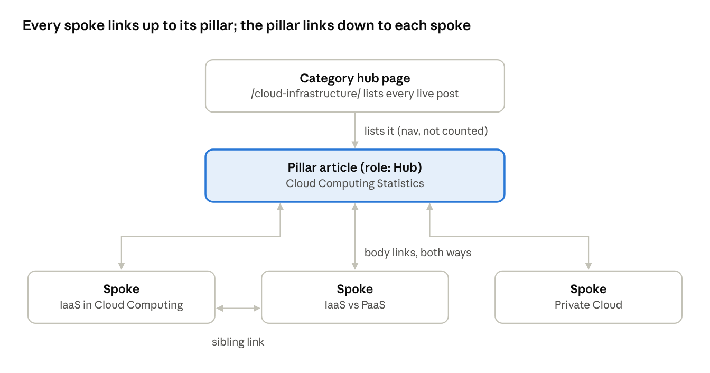

# SEO, AEO & GEO Site SOP

Oct 18, 2026 · @Darlene Aberin

Every brand site follows one rule: content lives in topic silos, each
silo has one pillar page, and every post links up to its pillar, across
to siblings, and gets linked to --- so no page is abandoned. This SOP is
the Stack Row process, written to reuse on any brand.

## The model

hub-and-spoke silo · Stack Row cloud example

One silo per topic folder. The category page lists every post but does
not count as a link; the pillar and its spokes link to each other in
their body text, and spokes add a sibling link.

## Step 1 --- Site foundations

Build these once per brand, into the site template, so every page
inherits them. Each item has an automated check; a failed check blocks
the release.

  -----------------------------------------------------------------------
  Item                  Rule                           How it is checked
  --------------------- ------------------------------ ------------------
  HTTPS                 Canonical and site URL use     Validator fails a
                        https://                       non-HTTPS site URL

  sitemap.xml           Lists live, indexable pages    Production build;
                        only, with lastmod             drafts and
                                                       scheduled posts
                                                       excluded

  robots.txt            Production allows crawling and Generated per
                        names the sitemap; staging     environment
                        disallows all                  

  noindex               Only on 404, drafts, scheduled Robots meta set by
                        posts and staging              the build, tested

  Canonical tag         One per page, absolute URL     Validator fails a
                                                       page without it

  Title + meta          Unique per page; description   QA script
  description           160 characters or fewer, no    
                        template text                  

  One H1, ordered       One H1, no skipped levels (H2  QA script
  headings              → H4)                          

  Images                Alt text, width and height,    Asset registry +
                        1600 and 800 px versions,      validator
                        compressed JPG                 

  og:image + social     Every page                     Validator
  tags                                                 

  Clean URL slugs       /silo/keyword-phrase/,         Content plan
                        lowercase, hyphens             review

  Mobile                Viewport tag, responsive       Template
                        layout                         

  Broken links          No internal link to a missing  Validator; build
                        route                          unlinks drafts
  -----------------------------------------------------------------------

## Step 2 --- Map the silos

Decide the silos before writing anything. A silo is one top-level URL
folder about one topic; its pillar is the broad post that answers the
head topic, and spokes are narrower posts beneath it.

1.  List the brand\'s 4 to 6 core topics. Each becomes a folder and a
    category hub page (for example /cybersecurity/).

2.  Pick one pillar per silo: the broadest, highest-volume keyword
    (often a \"statistics\" or \"guide\" piece). Give it role Hub in the
    content plan.

3.  List spokes under each pillar: specific questions, comparisons,
    vendor or cost pieces. Give them role Supporting or Commercial
    Support.

4.  A post that serves two silos is a Bridge. Place it in the folder it
    serves most.

5.  Record every post in the content plan with the fields below. Nothing
    is written until it has a row.

  ----------------------------------------------------------------------------------------
  Field             Example                               Why it matters
  ----------------- ------------------------------------- --------------------------------
  id                C2                                    Stable key for files and
                                                          research records

  title             IaaS vs PaaS: Choosing the Right      H1 and schema headline
                    Service Model                         

  primary_keyword   iaas vs paas                          Must appear in the title or H1
                                                          and the opening paragraph

  slug              /cloud-infrastructure/iaas-vs-paas/   First folder = the silo

  cluster           Cloud & Infrastructure                Topic grouping and section label

  role              Hub, Bridge, Supporting, Commercial   Decides who links to whom
                    Support                               

  targets           A5, C1, B8                            Planned internal links, checked
                                                          against the body
  ----------------------------------------------------------------------------------------

Keep 4 to 8 spokes per pillar. A pillar with no spokes yet (like SaaS at
launch) is a gap to fill next, not a reason to skip the silo.

## Step 3 --- Produce each post

A post moves through five gates in order. It stays a draft until the
last one passes.

1.  **Research record.** Live keyword data (volume, difficulty, intent)
    and the top 5 ranking competitors from Ubersuggest, plus every
    source URL with the date checked.

2.  **Draft.** Follow the writing rules below.

3.  **Fact-check.** Check every figure, price, date and product claim
    against the publisher\'s own page. Remove any claim that cannot be
    confirmed; never keep it \"to fix later\". Log each claim and its
    result in the research record.

4.  **QA.** Run the automated checks, then a human read for flow and
    accuracy of the new links.

5.  **Sign-off.** A named person records fact-check and QA approval with
    the date. Only then does the post switch from draft to published.

**Writing rules**

-   Primary keyword in the title or H1 and in the first paragraph.

-   Key Takeaways (or Key Statistics) and FAQ sections start straight
    with the list or questions, no intro line.

-   At least 3 FAQs, written as the questions people actually search.

-   At least 3 contextual external links to primary sources, placed on
    the sentence they support.

-   Worked examples use invented inputs and say so; every total is
    recalculated in QA.

-   No AI kill-list words (for example \"actually\", \"robust\",
    \"seamless\"), no em dashes, title-case headings.

-   Meta description: specific to the post, 160 characters or fewer.

-   One featured image per post, unique across the site, with alt text.

## Step 4 --- Contextual interlinking

Only links inside the body text count. Menus, category cards and
\"related\" lists help navigation but do not satisfy these rules,
because they carry no topical context.

  ------------------------------------------------------------------------
  Rule                   Applies to         Minimum
  ---------------------- ------------------ ------------------------------
  Link up to the pillar  Every spoke        1 body link to its own silo\'s
                                            pillar

  Link down to every     Every pillar       1 body link to each published
  spoke                                     spoke in its silo

  Receive links          Every published    2 body links from other posts
                         post               

  Link across            Spokes             1 to 2 links to siblings or a
                                            related silo, where it helps
                                            the reader

  Normal posts           Spokes             2 to 3 internal links total;
                                            pillars may exceed this to
                                            cover all spokes
  ------------------------------------------------------------------------

**How to write a contextual link**

-   Put it on the sentence where the linked topic already comes up, not
    in a link list.

-   Anchor text = the linked post\'s keyword or a close variant (\"IaaS
    vs PaaS\", \"private cloud architecture and costs\"), never \"click
    here\".

-   Add no new factual claim in the linking sentence. Describe only what
    the linked post covers.

-   When a new spoke is published, add the link from its pillar in the
    same release. Otherwise the check fails.

**Example (Stack Row cloud silo)**

Pillar: Cloud Computing Statistics. After its deployment-model section:
\"\[IaaS in cloud computing\] covers retained infrastructure duties,
\[IaaS vs PaaS\] compares the two service models, and \[private cloud
architecture and costs\] examines the exclusive deployment model.\" Each
spoke then links back to the pillar and to one sibling. Result: every
cloud post went from 1 inbound link to 3.

## Step 5 --- Schema

Schema is generated by the site build from each page\'s front matter,
never typed by hand per post. All entities on a page sit in one
connected JSON-LD \@graph and reference each other by \@id.

  ------------------------------------------------------------------------
  Page type          Schema types                  Key properties
  ------------------ ----------------------------- -----------------------
  Homepage           Organization, WebSite,        Organization name, url,
                     WebPage                       logo, slogan, email

  Topic hub          CollectionPage,               hasPart = every live
  (category)         BreadcrumbList, Organization, article in the silo
                     WebSite                       

  Article (pillar)   Article, WebPage,             headline, image,
                     BreadcrumbList, FAQPage,      datePublished,
                     Organization, WebSite         dateModified, isPartOf
                                                   = its hub, keywords

  Blog (spoke)       BlogPosting + the same as     Same as Article
                     Article                       

  About, Contact,    WebPage, BreadcrumbList,      name, description
  legal              Organization, WebSite         

  404                WebPage only                  noindex
  ------------------------------------------------------------------------

-   FAQPage is built from the post\'s FAQ section (each H3 question and
    its answer), so FAQ schema always matches what readers see.

-   Use a Person author only when a real, named author is approved for
    the byline. Otherwise the author is the Organization. Never invent
    an author.

-   Scheduled and draft posts are left out of hub hasPart lists until
    their publish date.

-   Validate a sample page in Google\'s Rich Results Test after any
    template change.

## Step 6 --- AEO and GEO

Answer engines (AI Overviews, featured snippets) and generative engines
(ChatGPT, Gemini, Perplexity) quote pages that answer clearly and are
easy to parse. Strong SEO from Steps 1 to 5 is the base; these steps add
on top.

1.  **Answer first.** The first sentence under each H2 states the answer
    or the point, with its number. Background comes after.

2.  **Question-shaped headings.** Use the way people ask (\"Who owns
    security after the move?\") for H2s and every FAQ.

3.  **FAQs that stand alone.** Each answer is 2 to 3 sentences and makes
    sense without the rest of the page, so it can be quoted as-is.

4.  **Tables for comparisons.** Put options, costs and responsibilities
    in tables, not paragraphs.

5.  **Cited facts.** Every statistic sits next to its primary-source
    link and says what it measures (population, year, denominator).
    Engines prefer claims they can attribute.

6.  **llms.txt.** The build writes /llms.txt listing every live post by
    silo, with title, URL and description, from the same set as the
    sitemap. Scheduled posts appear only on their publish date.

7.  **Keep it current.** Re-check changeable facts (prices, product
    limits) before each republish, and update dateModified when content
    changes.

To track progress, test the brand\'s key questions in ChatGPT, Gemini
and Google AI Mode every month and note which pages get cited.

## Step 7 --- Release and scheduling

Nothing is pushed straight to the live site. Every change goes feature
branch → staging → main, and posts publish themselves on their date.

1.  Work on a feature branch. Run the full check locally (build,
    validator, silo and schema checks, tests).

2.  Open a pull request into **staging**. CI runs the same checks;
    staging deploys as a noindex preview. Review the posts there.

3.  Merge with **\"Create a merge commit\"** when a branch must carry
    history into the next step. A squash merge can leave staging and
    main out of sync and cause false merge conflicts.

4.  Open a pull request from staging into **main**. Approve the
    production deploy when GitHub asks.

5.  **Scheduling:** each post has a published date. Production hides any
    post dated after today (UTC) from pages, sitemap, feed, schema and
    llms.txt. A nightly rebuild at 00:07 UTC (GitHub usually starts it
    30 to 40 minutes late) publishes that day\'s posts with no further
    push.

6.  Default cadence: 2 posts per day, one pillar-silo article and one
    blog where possible. Approve and merge the whole week\'s batch ahead
    of time.

7.  The morning after each publish date, confirm the nightly run
    succeeded. If it failed, read the logs and re-run the deploy
    manually.

## Step 8 --- Off-site and measurement

These live outside the code and need an owner per brand.

  -----------------------------------------------------------------------
  Task                            Tool                       When
  ------------------------------- -------------------------- ------------
  Verify the domain and submit    Google Search Console,     At launch
  sitemap.xml                     Bing Webmaster Tools       

  Install analytics               Google Analytics 4         At launch

  Check for manual actions and    Search Console             Weekly
  indexing errors                                            

  Measure Core Web Vitals on live PageSpeed Insights         At launch,
  pages                                                      then monthly

  Track rankings for each primary Ubersuggest (or the        Weekly
  keyword                         brand\'s rank tracker)     

  Find pages losing clicks or     Search Console Performance Monthly
  cannibalising each other        report                     

  Backlink gap and new link       Ubersuggest backlinks,     Monthly
  opportunities                   competitor review          

  Turn unlinked brand mentions    Brand monitoring           Monthly
  into links                                                 

  Google Business Profile         Google Business Profile    Only for
                                                             brands with
                                                             a physical
                                                             location

  AI visibility check             ChatGPT, Gemini, Google AI Monthly
                                  Mode                       
  -----------------------------------------------------------------------

## New-brand onboarding checklist

Work through these in order for each new brand. Steps 1 to 5 happen
once; 6 to 10 repeat for every batch of posts.

-   [ ] Copy the site template (build, validator, silo and schema
    checks, scheduling workflow) into the brand\'s repository

-   [ ] Set brand basics: name, domain (HTTPS), tagline, logo, colors,
    contact email

-   [ ] Define 4 to 6 silos and their folders; write the category hub
    pages

-   [ ] Fill the content plan: pillar per silo, spokes, keywords, slugs,
    roles, link targets

-   [ ] Set up Search Console, Bing Webmaster Tools and GA4; submit the
    sitemap

-   [ ] For each post: research record, draft, fact-check, QA, sign-off
    (Step 3)

-   [ ] Add contextual links: spoke → pillar, pillar → new spoke, one
    sibling link (Step 4)

-   [ ] Add a unique featured image with alt text

-   [ ] Set publish dates (2 per day), merge to staging, review, then
    release to main (Step 7)

-   [ ] Confirm each nightly publish, then run the monthly measurement
    tasks (Step 8)

## How Fin Loom implements this SOP

| SOP step | Where it lives | Check |
|---|---|---|
| 1. Foundations | `scripts/build.mjs`, `src/static/robots-*.txt` | `npm run check`, `npm run check:discoverability` |
| 2. Silo map | `data/supplementary-content-plan.json` (`silo_role`, `pillar`, `approved_outbound_targets`) | `npm test` |
| 4. Interlinking | Post body text (Resources links do not count) | `npm run check:silo` (also run by `npm run release:check`) |
| 5. Schema | `scripts/lib/seo.mjs`, `scripts/build.mjs` | `npm run check:discoverability` |
| 6. llms.txt | Built to `dist/llms.txt` from live posts | Build |
| 7. Scheduling | `scripts/lib/schedule.mjs`, `.github/workflows/scheduled-publish.yml` | `npm run schedule` |

Current pillars: Markets & Stocks: `/markets-stocks/stock-analysis-fundamentals/`; Investing: `/investing/crypto-vs-stocks/`; Crypto: `/crypto/crypto-custody/`; Money & Banking: `/money-banking/saving-vs-investing/`; Payments: `/payments/paypal-statistics/`; Fintech: `/fintech/dao-governance/`.
